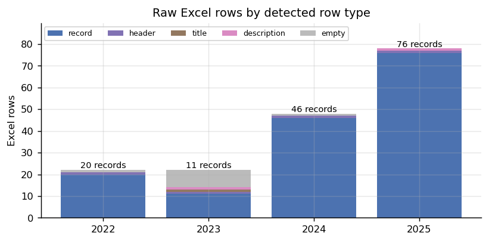
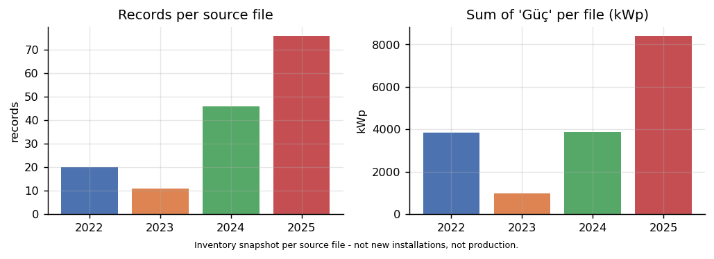

# 01 — Veri Denetimi (Görev 1.1, birinci kısım)

> İlgili kod: [`src/s01_ingest.py`](../src/s01_ingest.py) · Testler: [`tests/test_data_pipeline.py`](../tests/test_data_pipeline.py)
> Üretilen kayıtlar: `outputs/logs/raw_manifest.csv`, `outputs/logs/ingest_log.csv`, `outputs/tables/audit_row_types.csv`, `outputs/tables/summary_by_year.csv`

## 1. Amaç

Dört ham Excel dosyasını **hiç değiştirmeden** okumak, her gerçek kaydı kaynak dosya, sayfa ve Excel satırına geri izlenebilir biçimde tek tabloda toplamak. Kayıt olmayan her satırın neden atlandığını günlüğe yazmak. Bu adım model ya da temizleme kararı vermez; yalnız **neyin kayıt olduğunu** belirler.

## 2. Ham dosyalar ve sürüm kilidi

| Dosya | Sayfa | `max_row` × `max_col` | Birleşik hücre | sha256 (ilk 16) |
|---|---|---|---|---|
| `2022-yl-kurulumu-...xlsx` | `2022 KURULUMU TAMAMLANAN GES` | 22 × 6 | — | `e2983072e179f8bc` |
| `2023_kurulumu-...xlsx` | `2023 KURULUMU TAMAMLANAN GES` | 22 × 6 | `A15:C15` (boş) | `b760df1f9d02a636` |
| `2024-yl-kurulumu-...xlsx` | `2024 KURULUMU TAMAMLANAN GES` | 48 × 5 | — | `7c170eb8fb93609e` |
| `2025-yl-kurulumu-...xlsx` | `2025 KURULUMU TAMAMLANAN GES` | 78 × 5 | `A1:A2`, `B1:B2`, `D1:D2` | `32ba496529aa6805` |

- Tam sha256 değerleri `outputs/logs/raw_manifest.csv` ve `tests/test_data_pipeline.py::RAW_SHA` içinde. Test, ham dosyalardan biri değişirse **başarısız olur**.
- Ham veri repoya eklenmez (`.gitignore`). Dosyalar `data/raw/` altına konur, doğruluk sha256 ile kontrol edilir.

## 3. Ne yapıldı, nasıl yapıldı?

### Görev 3.1 — Her dosyanın yapısını ayrı ayrı çıkarmak
**Sorun:** Dört dosyanın düzeni farklı. Sabit “ilk satırı atla” mantığı yanlış satırları kayıt sayar.

| Dosya | Başlık satırı | Başlık öncesi/sonrası ek satırlar | Sütunlar |
|---|---|---|---|
| 2022 | 1 | 22. satır boş | `No, İlçe, Mekan, Güç, Ölçü / Birim, Durum` |
| 2023 | **2** | 1 = başlık metni; 3 = `(Aktif / Pasif)` açıklaması; 15–22 boş | `No, İlçe, Mekan, Güç, Ölçü / Birim, Durum` |
| 2024 | 1 | 48 boş | `İlçe, Mekan, Güç, Ölçü Birimi, Durum` (**No yok, birim başlığı farklı yazılmış**) |
| 2025 | 1 (A1:A2 birleşik) | 2 = `(kWp)` / `(Aktif / Pasif)` birim satırı | `İlçe, Mekan, Güç, Ölçü / Birim, Durum` (**No yok**) |

**Nasıl:** `openpyxl` ile her satır okunur.
1. Hücreleri Türkçe-duyarlı küçük harfe çevrilmiş satırlardan **`ilçe` içeren ilk satır başlık** kabul edilir. Başlıktan önceki dolu satırlar `title`, boş satırlar `empty` olarak işaretlenir.
2. Sütunlar **adla** eşlenir: `ölçü / birim` ve `ölçü birimi` aynı alana (`unit_raw`) gider. Zorunlu beş sütundan biri eksikse betik durur.
3. Başlıktan sonra bir satır yalnız **`Güç` hücresi sayısal ise** (`int`/`float`, `bool` değil) kayıt sayılır. Sayısal olmayan dolu satırlar `description` (birim/açıklama satırı), tamamen boş satırlar `empty` olarak günlüğe yazılır.



### Görev 3.2 — İzlenebilir kimlik
Her kayda `record_id = GES-{dosya_yılı}-{excel_satırı:03d}` verilir (ör. `GES-2024-013`). Kimlik satır numarasından deterministik üretilir; okuma sırasına bağlı değildir. Kayıtta ayrıca `source_file`, `sheet`, `excel_row`, `file_year` ve (varsa) `source_no` tutulur.

> **`file_year` = kaynak sürümü.** Dosya adları “kurulumu tamamlanan” dese de kayıtların o yıl kurulduğu kanıtlanamaz (2025 dosyası önceki yılların tesislerini tekrar içeriyor, bkz. [03](03_tesis_eslestirme.md)). Bu yüzden hiçbir yerde “kurulum yılı” ifadesi kullanılmaz.

### Görev 3.3 — Atlanan her satırın günlüğü
`outputs/logs/ingest_log.csv`, **her fiziksel satır için tam bir kayıt** içerir: `source_file, sheet, excel_row, action, reason, raw_values` (ham hücreler JSON). Test `test_every_skipped_row_logged`, her dosyada 1..`max_row` satırlarının günlükte birer kez geçtiğini doğrular.

| Dosya | record | header | title | description | empty |
|---|---|---|---|---|---|
| 2022 | 20 | 1 | 0 | 0 | 1 |
| 2023 | 11 | 1 | 1 | 1 | 8 |
| 2024 | 46 | 1 | 0 | 0 | 1 |
| 2025 | 76 | 1 | 0 | 1 | 0 |

Atlanan anlamlı satırlar:
- 2023 satır 1: `" 2023 Yılında Kurulumu Tamamlanan Güneş Enerji Sistemi (GES) Yerleri "` → **title**
- 2023 satır 3: yalnız Durum sütununda `(Aktif / Pasif)` → **description** (sütun açıklaması)
- 2025 satır 2: `Güç = "(kWp)"`, `Durum = "(Aktif / Pasif)"` → **description** (birim satırı)

### Görev 3.4 — Sayısal doğrulama (assert)
Betik, aşağıdakiler tutmazsa **durur**:

| Dosya yılı | Kayıt | Güç toplamı (kWp) | Medyan | Min–maks | İlçe etiketi |
|---|---|---|---|---|---|
| 2022 | 20 | 3.834,8 | 106 | 20–574,2 | 15 |
| 2023 | 11 | 984,7 | 25 | 6,6–305 | 9 |
| 2024 | 46 | 3.887,0 | 36 | 3–484 | 21 |
| 2025 | 76 | 8.418,0 | 63 | 3–574 | 34 |
| **Toplam** | **153** | | | | |



> Bu toplamlar **dosyadaki Güç sütununun toplamıdır**: benzersiz tesis kapasitesi, yıllık eklenen kapasite veya büyüme eğrisi **değildir**. 153 kayıt ≈ 76 farklı tesis grubuna karşılık gelir ([03](03_tesis_eslestirme.md)).

## 4. Denetimde tespit edilen kalite bulguları (özet)

Ayrıntılı ele alınışı [02 — Temizleme ve ön işleme](02_veri_temizleme_on_isleme.md) ve [03 — Tesis eşleştirme](03_tesis_eslestirme.md) içindedir.

| # | Bulgu | Konum | Nerede ele alındı |
|---|---|---|---|
| Q1 | İlçe yazım hatası `Atnavutköy` | 2022 satır 5 | 02, R-DIST-01 |
| Q2 | İlçede sondaki boşluk `Sultangazi ` | 2024 s.42, 2025 s.69 | 02, R-WS-01 |
| Q3 | Bölünmez boşluk `\xa0` | 2022 s.19 | 02, R-WS-01 |
| Q4 | Mekan adlarında sondaki/çift boşluk | 84 kayıt | 02, R-WS-01 |
| Q5 | Başlık/açıklama satırları | 2023 s.1–3, 2025 s.2 | bu belge, §3.3 |
| Q6 | Kayıtta `Durum = (Aktif / Pasif)` | 2024 s.2 (Ataşehir İtfaiye) | 02, R-STAT-04 |
| Q7 | `Durum = Aktif - Pasif` | 2025 s.14, s.17 | 02, R-STAT-03 |
| Q8 | Aynı tesis–yıl için iki farklı güç | 2024 s.13 (29) ve s.15 (25), Ömerli İtfaiye | 03, karantina |
| Q9 | İlçe çelişkisi | Kumburgaz İtfaiye: 2023 Silivri, 2024–25 Büyükçekmece | 03 |
| Q10–12 | Etap ↔ bütün kayıtları | Engelliler Merkezi, Ataköy, Cemal Kamacı | 03 |
| Q13 | Ad içinde başka tesisin adı | 2022 İPA adı “Florya Atatürk Kent Ormanı”nı içeriyor | 03 |
| Q14 | Aynı ad, farklı ilçe | 2025 “Mezarlığı Hizmet ve Gasilhane” (Arnavutköy/Silivri); 2024 “İBB İtfaiye” (Ataşehir/Küçükçekmece) | 03 |
| Q15 | Ad kalıbı dosya yılını sızdırıyor | GES / (GES) / Güneş Enerji Santrali | 02, R-NAME-02 |
| Q16 | Alt birimler | Maltepe Orhangazi Parkı 6 birim | 03, kural A0 |
| Q17 | Aynı birimin yıllar arası güç farkı | Kumburgaz 100/106/88 vb. | 04, gürültü tabanı |
| Q18 | Birim | Tüm kayıtlar `kWp` | 02, R-UNIT-01 (0 ihlal) |

## 5. Çalıştırma

```bash
cd src && python s01_ingest.py
# records: 153  per year: {2022: 20, 2023: 11, 2024: 46, 2025: 76}
```
Çıktı: `outputs/data/records_raw.csv` (repoya eklenmez; veri dosyası).
