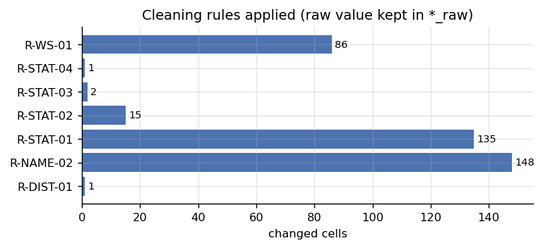
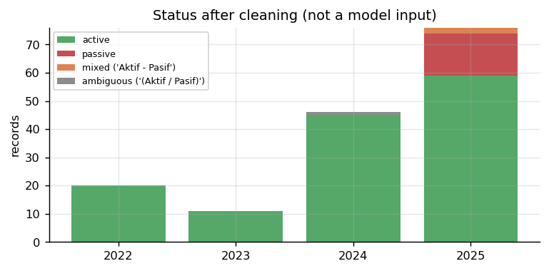
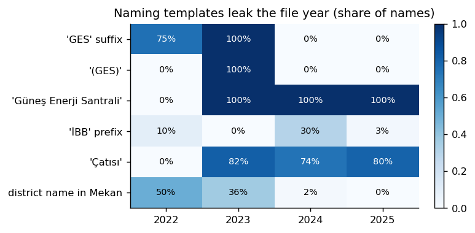

# 02 — Veri Temizleme ve Ön İşleme (Görev 1.1, ikinci kısım)

> İlgili kod: [`src/s02_clean.py`](../src/s02_clean.py), yardımcılar [`src/common.py`](../src/common.py)
> Protokol dosyası: [`protocol/district_corrections.csv`](../protocol/district_corrections.csv)
> Günlük: `outputs/logs/cleaning_log.csv` (`record_id, field, raw, clean, rule_id`)

## 1. İlke: ham değer asla üzerine yazılmaz

Her alan için iki sütun tutulur: `*_raw` (Excel'deki değer, dokunulmamış) ve `*_clean` (kurallı değer). Her değişiklik bir **kural kimliği** ile `cleaning_log.csv`'ye yazılır. Böylece savunmada “bu değer nereden geldi?” sorusu satır satır cevaplanabilir.



| Kural | Ne yapar | Değişen hücre |
|---|---|---|
| **R-WS-01** | Unicode NFC, `\xa0` → boşluk, çoklu boşluk → tek boşluk, baş/son boşluk silme | 86 |
| **R-DIST-01** | Açık ilçe yazım düzeltmesi (protokol dosyasından) | 1 |
| **R-NAME-02** | Yıla özgü ad kalıplarını model metninden çıkarma | 148 |
| **R-STAT-01..04** | Durum normalizasyonu | 153 (135 + 15 + 2 + 1) |
| **R-UNIT-01** | Birim `kWp` kontrolü | 0 ihlal |

## 2. Görevler — ne yapıldı, nasıl yapıldı?

### Görev 2.1 — Boşluk ve Unicode normalizasyonu (R-WS-01)
- **Neden:** `Sultangazi ` (sonda boşluk) ile `Sultangazi` iki ayrı ilçe gibi sayılırdı. Güngören kaydındaki `\xa0` (bölünmez boşluk) gözle görülmez ama eşleştirmeyi bozar.
- **Nasıl:** `common.basic_clean`: `unicodedata.normalize("NFC")` → `\xa0` → boşluk → `\s+` → tek boşluk → `strip()`.
- **Sonuç:** 84 Mekan hücresi ve 2 İlçe hücresi değişti; 84 kayıtta `whitespace_fixed` bayrağı. İlçe sayısı düzeltme sonrası 2024'te 21, 2025'te 34 (çift sayım yok).

### Görev 2.2 — İlçe yazım düzeltmesi (R-DIST-01)
- **Bulgu:** 2022 satır 5: `İlçe = Atnavutköy`. İstanbul'da böyle bir ilçe yok; aynı satırın Mekan alanı “**Arnavutköy** Mezarlığı Hizmet ve Gasilhane Binası GES”.
- **Nasıl:** Düzeltme koda gömülmez; [`protocol/district_corrections.csv`](../protocol/district_corrections.csv) içinde `raw_value, normalized_value, rule_id, confidence, evidence` olarak durur. Kod yalnız bu tabloyu uygular. Güven “high”, kanıt aynı satırın Mekan alanı.
- **Bayrak:** `district_typo_fixed`. `district_raw = Atnavutköy` korunur.

### Görev 2.3 — Durum normalizasyonu (R-STAT)
| Ham değer | `status_clean` | Kural | Adet | Gerekçe |
|---|---|---|---|---|
| `Aktif` | `aktif` | R-STAT-01 | 135 | |
| `Pasif` | `pasif` | R-STAT-02 | 15 (hepsi 2025) | |
| `Aktif - Pasif` | **`karma`** | R-STAT-03 | 2 (2025: Florya, Başakşehir İtf.) | İki kelime birden; hangisinin geçerli olduğu bilinemez → zorla aktif/pasif yapılmaz |
| `(Aktif / Pasif)` | **`belirsiz`** | R-STAT-04 | 1 (2024 Ataşehir İBB İtfaiye) | Sütun açıklama metni kayda kopyalanmış; aktiflik bilgisi taşımaz |

- 2025'te **açıkça Pasif = 15**; karma 2 kayıt bu sayıya **eklenmez** (test `test_status_counts`).
- `status_clean` **ana modele girdi değildir** (yönerge). Yalnız RAG kanıtında ve betimsel analizde kullanılır.



### Görev 2.4 — Yıl kalıbı sızıntısının temizlenmesi (R-NAME-02)
- **Bulgu:** Tesis adlarının **yazım kalıbı dosya yılını ele veriyor**:



  - 2022: `… GES` (%75), 2023: `… Güneş Enerji Santrali (GES)` (%100), 2024–2025: `… Güneş Enerji Santrali` (%100).
  - Bu ekler temizlenmezse model, `[YIL]` tokenı çıkarılsa bile dosya yılını adın son ekinden öğrenir. Zorunlu **ablasyon (3) “dosya yılını çıkar” anlamsız** hâle gelir.
- **Nasıl:** `common.strip_boilerplate`. Türkçe-duyarlı küçük harfte `güneş enerji santrali (ges)`, `güneş enerji santrali`, `(ges)`, `\bges\b` aralıkları bulunur ve orijinal metinden çıkarılır (büyük/küçük harf korunur). Tire biçimi normalize edilir (`Parkı- X` → `Parkı - X`).
- **Korunanlar:** İçerik sözcükleri (`Çatısı`, `İtfaiye`, `Park`, `Yüzme Havuzu` …), Türkçe karakterler, etap ve alt birim numaraları (`1. Etap`, `(2)`, `75. Yıl`).
- **Kalan yıl sinyali (bilerek bırakıldı, raporlandı):** `çatısı` 2023–2025 adlarının ~%75–80'inde var, 2022'de yok; `İBB` öneki 2024'te %30. Bunlar içerik sözcüğü olduğu (çatı GES'i ile arazi GES'ini ayırır) için silinmedi. Ablasyon yorumunda bu kalan sinyal hesaba katılır. Token–yıl tablosu `outputs/tables/token_year_counts.csv`, görsel [04](04_kesifsel_veri_analizi.md) Şekil 16.
- **Sonuç:** 148 kayıtta ad kısaldı; 5 kayıtta (ör. 2022 “Fatih Spor Kompleksi”) kalıp zaten yoktu. Test `test_no_year_template_tokens_left`: hiçbir `name_clean` içinde `ges` / `güneş enerji santrali` kalmadı.

### Görev 2.5 — Birim kontrolü (R-UNIT-01)
Tüm 153 kayıtta `unit_clean == "kWp"`. İhlal olsaydı `unit_issue` bayrağı ve dönüşüm kuralı gerekirdi. Assert ile kontrol edilir.

### Görev 2.6 — Sayısal alan
`power_kwp = float(power_raw)`. Ondalıklar korunur (2022: 105,6 ve 574,2; 2023: 8,5 ve 6,6). 2024–2025 değerleri tamsayı; bu, aynı tesisin yıllar arasındaki küçük farklarını kısmen açıklar (574,2 → 574). Negatif, boş veya sonsuz değer **yok**.

### Görev 2.7 — Türkçe-duyarlı küçük harf
Python'un `str.lower()` fonksiyonu `İ` → `i̇` (noktalı i + birleşik nokta) ve `I` → `i` üretir; Türkçe için yanlıştır. `common.tr_lower` önce `İ→i`, `I→ı` dönüşümünü yapar (test `test_turkish_lower`). Eşleştirme, tokenizasyon ve TF-IDF bu fonksiyonu kullanır.

## 3. Üretilen tablo şeması (`outputs/data/records_clean.csv`)

| Alan | Tip | Açıklama |
|---|---|---|
| `record_id` | str | `GES-YYYY-RRR` |
| `source_file`, `sheet`, `excel_row`, `file_year`, `source_no` | | kaynak izi |
| `district_raw` / `district_clean` | str | ham / R-WS-01 + R-DIST-01 |
| `name_raw` | str | Excel'deki Mekan hücresi |
| `name_ws` | str | yalnız boşluk normalize (RAG ve görüntüleme) |
| `name_clean` | str | **model metni**: yıl kalıpları çıkarılmış |
| `power_raw` / `power_kwp` | float | hedef değişken (**girdi değil**) |
| `unit_raw` / `unit_clean` | str | |
| `status_raw` / `status_clean` | str/enum | `aktif / pasif / karma / belirsiz` (**girdi değil**) |
| `unit_no`, `match_key` | | yalnız eşleştirme için ([03](03_tesis_eslestirme.md)) |
| `unit_id`, `entity_group_id` | str | [03](03_tesis_eslestirme.md) |
| `quality_flag` | str | `;` ile ayrılmış bayraklar |
| `in_regression` | bool | karantinadaki kayıtlar `False` |

**Kalite bayrakları:** `ok`, `whitespace_fixed`, `district_typo_fixed`, `status_ambiguous`, `status_mixed`, `unit_issue`, `conflict_same_year`, `district_conflict`, `phase_merge_candidate`, `name_overlap_other_unit`.

## 4. Çalıştırma ve testler

```bash
cd src && python s02_clean.py
cd .. && python -m pytest tests/test_data_pipeline.py -q
```
İlgili testler: `test_status_counts`, `test_district_typo`, `test_turkish_lower`, `test_boilerplate_removal_removes_year_templates`, `test_no_year_template_tokens_left`.
