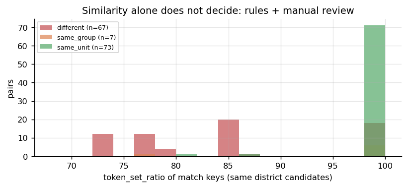
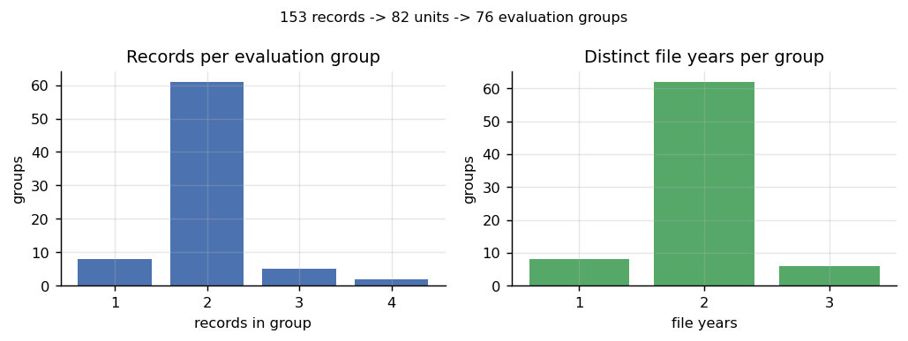
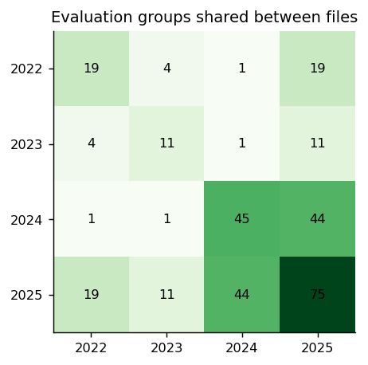

# 03 — Tesis Eşleştirme ve Çelişki Yönetimi (Görev 1.2)

> İlgili kod: [`src/s03_match.py`](../src/s03_match.py)
> Protokol: [`protocol/matching_decisions.csv`](../protocol/matching_decisions.csv) (manuel kararlar, v1.0), [`protocol/site_subunits.csv`](../protocol/site_subunits.csv)
> Günlükler: [`outputs/logs/matching_log.csv`](../outputs/logs/matching_log.csv) (her aday çift: skorlar, öneri, karar, gerekçe), [`outputs/logs/entities.csv`](../outputs/logs/entities.csv)

## 1. Neden bu adım en kritik adım?

153 kayıt 153 farklı tesis değildir. 2025 dosyası önceki yılların tesislerinin çoğunu yeniden listeliyor. Aynı tesisin bir yılı eğitimde, başka bir yılı testte olursa model adı ezberleyip neredeyse aynı gücü “tahmin eder”. Bu genelleme değil, **sızıntıdır**. Bu yüzden değerlendirme **tesis grubuna** göre bölünür ve grup kimliğinin doğru olması gerekir.

**Yönerge kısıtları (kodda uygulanır):**
- **Güç ve durum eşleştirme kararında kullanılmaz.** `s03_match.py` yalnız `record_id, file_year, district_clean, name_ws` sütunlarıyla çalışır; güç/durum sütunlarının olmadığını `assert` eder. Test `test_matching_does_not_read_power` bunu kaynak koddan doğrular.
- Etaplar ve “Su Deposu Üzeri (1), (2), (3)” gibi alt birimler gerekçesiz birleştirilmez.
- Aynı olası tesise ait tüm kayıtlar aynı değerlendirme grubunda kalır.
- Çelişkiler silinmez veya ortalanmaz; karantinaya alınır.

## 2. İki seviyeli kimlik (tasarım kararı)

Yönergenin iki isteği ilk bakışta çelişir: “etapları birleştirme” ve “aynı olası tesisi aynı grupta tut”. Çözüm iki ayrı kimlik:

| Kimlik | Anlamı | Nerede kullanılır |
|---|---|---|
| `unit_id` (dar) | **Kesin aynı fiziksel GES birimi** (ör. Bahar Merkezi 2024 ↔ 2025) | RAG yanıtları, gürültü tabanı, çelişki tespiti |
| `entity_group_id` (geniş) | `same_unit` ve `same_group` bağlantılarının **bağlı bileşeni** (union-find) | **GroupKFold**, tesis dengeli MAE |

Örnek: Başakşehir Engelliler Merkezi 2022'de iki satır (1. Etap 99 kWp, 2. Etap 80 kWp), 2025'te tek satır (179 kWp). Etaplar **ayrı birim**dir (`unit_id` farklı). 2025 kaydı ikisini birden kapsadığı için dördü **aynı değerlendirme grubundadır**. Bu bir birleştirme değil, sızıntı önleme kararıdır.

## 3. Algoritma — adım adım

### Adım 3.1 — Eşleştirme anahtarı (`match_key`)
`name_ws` üzerinde:
1. Yıl kalıpları silinir (`strip_boilerplate`, bkz. [02](02_veri_temizleme_on_isleme.md)).
2. Etap/alt birim numarası ayrı alana alınır (`unit_no`). Desenler: `N. Etap`, `Etap N`, `(N)`. `75. Yıl` gibi ifadeler etap sayılmaz.
3. Türkçe küçük harf tokenizasyonu.
4. Stil sözcükleri silinir: `ibb`, `çatısı`, `bina`, `binası`. Bunlar yıllara göre değişen yazım alışkanlıkları ([04](04_kesifsel_veri_analizi.md) Şekil 16).
5. Kaydın **kendi ilçesinin** tokenları silinir: 2022 “Silivri Mezarlığı …” ↔ 2025 “Mezarlığı …”. Başka ilçe adı silinmez (Fatih'teki “**Silivri** Kapı Buz Pisti” korunur).

Örnek: `Ataköy Kadın Koordinasyon Müdürlüğü Bina Çatısı Güneş Enerji Santrali (GES) - Etap 2` → `match_key = "ataköy kadın koordinasyon müdürlüğü"`, `unit_no = 2`.

### Adım 3.2 — Aday çiftler
Tüm 153×152/2 çift taranır (`rapidfuzz.fuzz.token_set_ratio`):
- **Aynı ilçe** ve oran ≥ 70 → aday,
- **Farklı ilçe** ve oran ≥ 90 → aday (ilçesi yeniden etiketlenmiş tesisleri yakalamak için; ör. Kumburgaz).

Sonuç: **430 aday çift** (+2 aday olmayan manuel karar).

### Adım 3.3 — Otomatik öneri kuralları (sırayla)
| Kural | Koşul | Öneri | Adet |
|---|---|---|---|
| A1 | farklı ilçe | `different` | 283 |
| A2 | aynı dosya (aynı yıl) | `different` (aynı dosyada iki satır = iki birim varsayımı) | 35 |
| A0 | ikisi de beyan edilmiş çok birimli sitede (Maltepe Orhangazi Şehir Parkı) | aynı alt birim adı **ve** numara → `same_unit`, değilse `different` | 6 / 30 |
| A3 | iki tarafta da etap numarası var ve farklı | `different` | 1 |
| A7 | anahtarlar farklı ve biri **tek sözcük** (ör. `itfaiye` ⊂ `kumburgaz itfaiye`) | `review` | 2 |
| A4 | bir tarafta etap no var, diğerinde yok, oran ≥ 90 | `same_group` (etap ↔ bütün) | 4 |
| A4b | aynı durum, oran < 90 | `review` | 1 |
| A5 | aynı ilçe, farklı yıl, oran ≥ 90 | `same_unit` | 66 |
| A6 | aynı ilçe, farklı yıl, 70 ≤ oran < 90 | `review` | 2 |

**`review` önerisi alan bir çift için manuel karar yoksa betik durur.** Hiçbir belirsiz çift sessizce geçmez.

**Kurallar nasıl bulundu?** İlk sürümde A0 ve A7 yoktu. Otomatik `same_unit` listesi tek tek okununca iki hata sınıfı çıktı:
1. `token_set_ratio` alt küme ilişkisinde 100 verir. 2024'teki genel “İBB **Büyükçekmece** İtfaiye” (anahtar: `itfaiye`) 2025'teki Kumburgaz ve Mimar Sinan itfaiyeleriyle “aynı” çıktı → **A7** eklendi.
2. Maltepe Orhangazi Parkı'nın 6 alt birimi (Atletizm Pisti, Su Deposu (1)(2)(3), Şeflik, Tenis) etap kuralı yüzünden birbirine bağlanıyordu → site bilgisi [`protocol/site_subunits.csv`](../protocol/site_subunits.csv) ile beyan edildi, **A0** eklendi.

### Adım 3.4 — Manuel kararlar (12 karar, gerekçeli)
Tamamı [`protocol/matching_decisions.csv`](../protocol/matching_decisions.csv) içinde, gerekçe ve güven düzeyiyle:

| Çift | Karar | Güven | Gerekçe (kısa) |
|---|---|---|---|
| İPA 2022 ↔ Florya 2024, 2025 | `same_group` | orta | 2022 İPA adı “(İPA – Florya Atatürk Kent Ormanı)”; 2025'te İPA (20 kWp) ve Florya (7 kWp) ayrı satır → ayrı birim, **ad örtüşmesi** nedeniyle aynı grup |
| Ataköy 2022 ↔ 2023 “Etap 2” ↔ 2025 “Sosyal Hizmetler Daire Bşk.” | `same_group` ×3 | orta | aynı Ataköy sosyal hizmet yerleşkesi; etap/bütün ilişkisi |
| Kayışdağı Darülaceze 2022 ↔ 2025 | `same_unit` | orta | “Müdürlüğü” ↔ “Ana Kampüsü”, özel ad aynı |
| Topkapı Deprem Parkı tuvaleti 2023 ↔ 2025 | `same_unit` | yüksek | yalnız “(Kültür)” eklenmiş |
| 2024 “Büyükçekmece İtfaiye” ↔ 2025 Kumburgaz / Mimar Sinan | `different` ×2 | yüksek | ikisinin de 2024 karşılığı ayrıca var |
| Kumburgaz 2023 (Silivri) ↔ 2024, 2025 (Büyükçekmece) | `same_unit` ×2 | orta | özel ad aynı, **ilçe çelişkisi** bayraklanır |
| Ömerli 2024 s.13 ↔ s.15 | `same_unit` | orta | aynı dosyada aynı ad + ilçe → **aynı tesis–yıl çelişkisi** |

Karar dağılımı: otomatik 420 (346 `different`, 70 `same_unit`, 4 `same_group`) + manuel 12 (5 `same_unit`, 5 `same_group`, 2 `different`).

### Adım 3.5 — Union-find ve kalite bayrakları
- `same_unit` kenarları → `unit_id` (U000…); `same_unit` + `same_group` kenarları → `entity_group_id` (G000…).
- Bir `unit_id` içinde aynı dosya yılı iki kez geçiyorsa → `conflict_same_year` (yalnız Ömerli).
- Bir `unit_id` birden fazla ilçe taşıyorsa → `district_conflict` (Kumburgaz, 3 kayıt).
- `same_group` kenarına katılan kayıtlar → `phase_merge_candidate` (9) veya `name_overlap_other_unit` (3).

## 4. Sonuç

**153 kayıt → 82 birim → 76 değerlendirme grubu.**

| Grup büyüklüğü | 1 | 2 | 3 | 4 |
|---|---|---|---|---|
| Grup sayısı | 8 | 61 | 5 | 2 |

- Tek kayıtlı 8 grup: 2024 Büyükçekmece İtfaiye ve yalnız 2025'te geçen 7 tesis (Bayrampaşa ×2, Kadıköy Filiz Akın, Kartal Yakacık ve Yunus Çocuk Eğitim, Küçükçekmece Traker, Pendik Yenişehir İtfaiye Eğitim).
- 4 kayıtlı gruplar: İPA + Florya (G000), Engelliler Merkezi (G010).

**2024'teki 45 grubun 44'ü 2025'te de var; 2022'deki 19 grubun 19'u 2025'te de var.** Satır bazında rastgele bölmenin neden ağır sızıntı üreteceği bu tablodan görülür (sayısal kanıt: [05](05_protokol_ve_bolme.md)).

## 5. Karantina (Ömerli İtfaiye)

| record_id | Excel satırı | Güç | Karar |
|---|---|---|---|
| GES-2024-013 | 13 | 29 kWp | `in_regression = False` |
| GES-2024-015 | 15 | 25 kWp | `in_regression = False` |
| GES-2025-026 | 26 | 28 kWp | regresyonda (aynı yıl çelişkisi yok) |

- İki 2024 kaydı **silinmedi, ortalanmadı**. Regresyon eğitiminden ve testinden çıkarıldılar, RAG bilgi tabanında çelişki etiketiyle duruyorlar.
- Üç kayıt da aynı `entity_group_id`'dedir (G035). İleride karantina kaldırılsa bile aynı katta kalırlar.
- Regresyon kayıt sayısı: **151**.

## 6. Testler
`test_matching_groups` (etaplar, Maltepe alt birimleri, aynı ad farklı ilçe, İPA/Florya, genel itfaiye, Kumburgaz, 76 grup), `test_quarantine`, `test_matching_does_not_read_power`.
