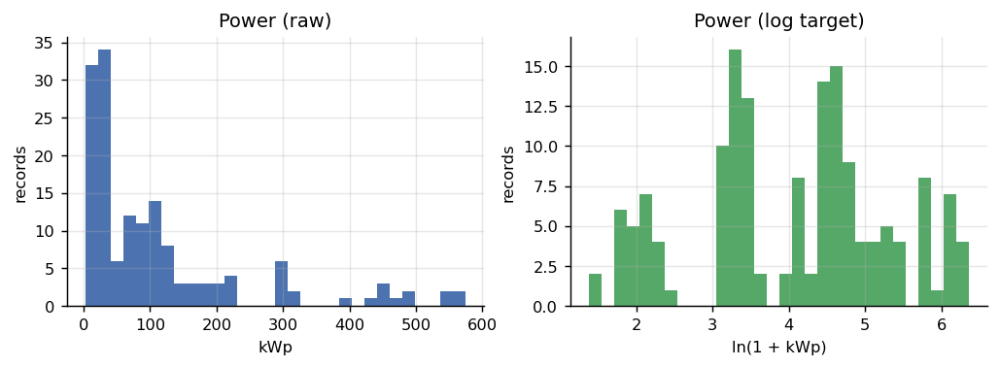
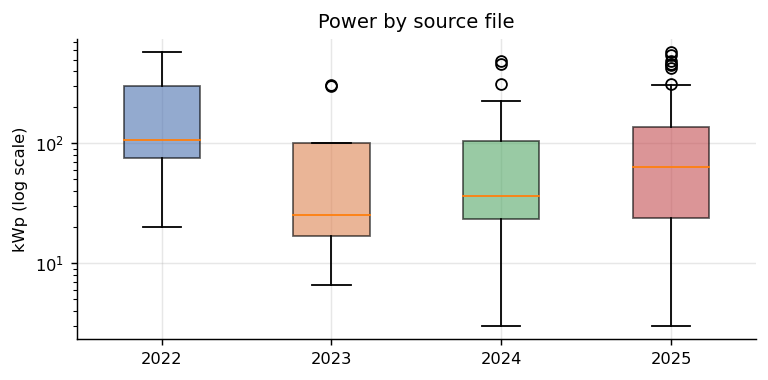
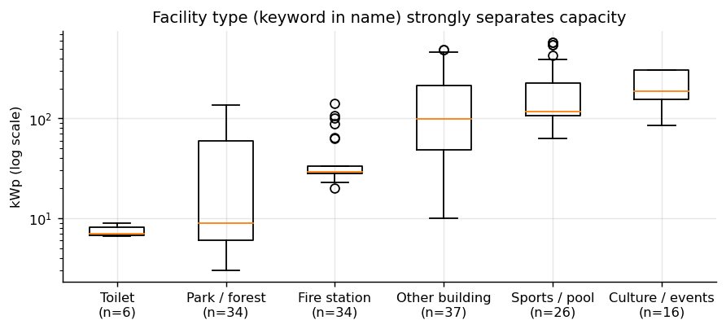
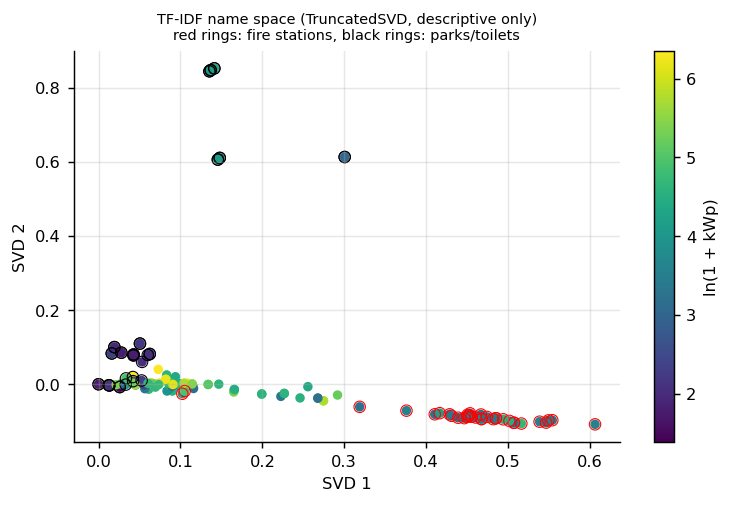
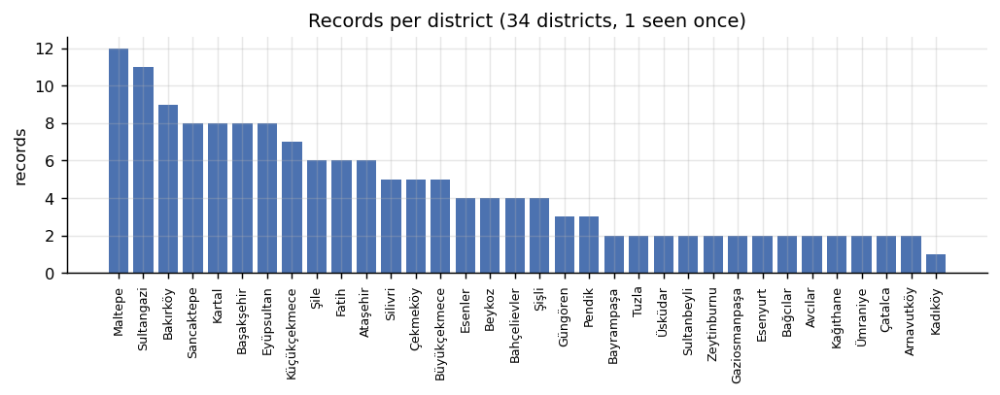
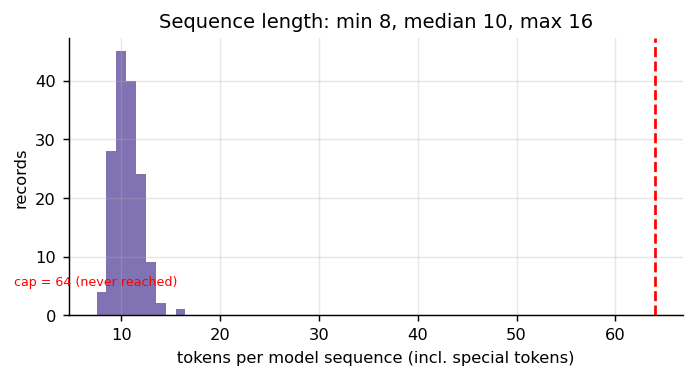
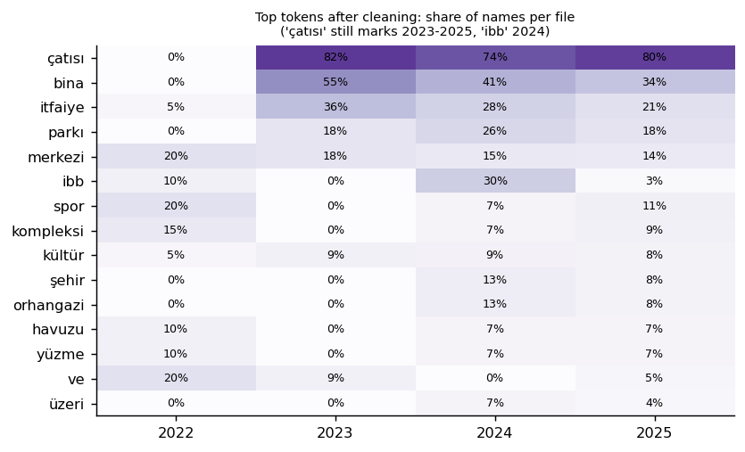
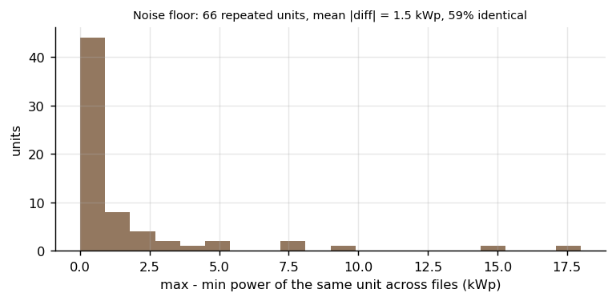

# 04 — Keşifsel Veri Analizi (EDA)

> İlgili kod: [`src/s04_eda.py`](../src/s04_eda.py) · Tablolar: `outputs/tables/*.csv`
> **Kural:** Bu belgedeki analizler betimseldir; hiçbir model/hiperparametre kararı test katlarına bakılarak verilmedi. Dosya yılı toplamları “yeni kurulum” veya “üretim” değildir.

## 1. Hedef değişkenin dağılımı

| İstatistik | kWp | ln(1+kWp) |
|---|---|---|
| ortalama | 111,9 | 4,04 |
| std | 134,6 | 1,26 |
| min / Q1 / medyan / Q3 / maks | 3 / 25 / 70 / 118 / 574,2 | 1,39 / 3,26 / 4,26 / 4,78 / 6,35 |
| çarpıklık | **1,90** | **−0,17** |

**Sonuç:** Ham güç sağa çok çarpık; birkaç büyük tesis (Buz Pisti 574, Fatih Spor 550, Cebeci 484, Bahar 458–461) kare hatayı domine eder. `ln(1+y)` dönüşümü dağılımı neredeyse simetrik yapıyor (çarpıklık −0,17). Yönergedeki hedef dönüşümü (`z = ln(1+y)`) bu yüzden uygun; ters dönüşüm yanlılığı [06 — M4](06_matematik.md)'te tartışılıyor.

Dosya medyanları 106 / 25 / 36 / 63 kWp. 2023 dosyası küçük tesislerden (tuvalet 6,6 kWp, itfaiye 25 kWp) oluştuğu için medyanı düşük. Yani **dosya yılı etkisi ile hangi tesislerin o dosyada olduğu karışık**: yıl bir “nedensel” etki olarak yorumlanamaz.

## 2. Tesis türü: en güçlü sinyal

Ad içindeki anahtar sözcüğe göre (yalnız betimsel sınıflama; modele girmez):

| Tür (adda geçen) | n | medyan kWp | Q1–Q3 |
|---|---|---|---|
| Toilet (`tuvalet`) | 6 | 7,0 | 6,7–8,1 |
| Park / forest (`park, orman, koru, bahçe, gölet`) | 34 | 9,0 | 6–60 |
| Fire station (`itfaiye`) | 34 | **29,0** | 28–33 |
| Other building | 37 | 98,0 | 48–215 |
| Sports / pool (`spor, yüzme, havuz, pist, buz`) | 26 | 118,0 | 106–226 |
| Culture / events (`kültür, sahne, davet, toplantı`) | 16 | 188,0 | 155–303 |

**Yorum:** İtfaiye çatıları çok dar bir aralıkta (28–33 kWp, standart proje); tuvaletler 7 kWp civarında. Modelin öğrenebileceği asıl ilişki **“tür sözcüğü → büyüklük ölçeği”**. Bu, attention için bir hipotez de üretir: D2'nin öğrenilen sorgusu `itfaiye`, `park`, `kompleksi` gibi tür tokenlarına ağırlık verirse ortalamaya göre fayda sağlayabilir (H1, [05](05_protokol_ve_bolme.md)). Parkların geniş aralığı (Hoşdere 120–135 kWp, Su Deposu 57–78 kWp ile 3–9 kWp'lik küçük park GES'leri) bu türde hatanın büyük olacağını gösteriyor.

TF-IDF ad uzayının iki boyutlu görüntüsü (scikit-learn `TfidfVectorizer` + `TruncatedSVD`, yalnız betimsel):

İtfaiyeler (kırmızı halka) ad uzayında sıkı bir küme oluşturuyor; renk (log güç) bu kümede homojen. Park ve tuvaletler başka bir bölgede. Doğrusal bir TF-IDF + Ridge modelinin (B1) güçlü bir referans olacağı buradan öngörülebilir.

## 3. İlçe dağılımı ve `[UNK]` riski

- 34 ilçe; 14 ilçe en fazla 2 kayıtla geçiyor, Kadıköy yalnız 1 kez.
- Gruplu bölmede bir ilçenin tüm kayıtları test katına düşebilir → ilçe tokenı testte `[UNK]` olur. Bu nedenle sözlükte `min_freq = 2` kuralı ve eğitimde `[UNK]` embedding'inin gerçekten öğrenilmesi şart ([07](07_tokenizasyon_ve_girdi.md)).

## 4. Dizi uzunluğu

`[CLS] [ILCE] <ilçe> [YIL] <yıl> [MEKAN] <ad>` biçiminde dizi uzunluğu **min 8, medyan 10, maks 16**. Yönergedeki 64 üst sınırına hiç ulaşılmıyor; **kesilen kayıt sayısı = 0**. Eğitimde `max_len` her iç eğitimin en uzun dizisinden seçiliyor.

## 5. Kalan yıl sinyali (temizlikten sonra)

Yıl kalıpları çıkarıldıktan sonra yalnız tek bir dosyada geçen sık token **kalmadı**. Yine de `çatısı` 2022'de hiç yok, 2023–2025'te ~%75–80; `ibb` 2024'te belirgin. Bu tokenlar içerik sözcüğü olarak bırakıldı ([02](02_veri_temizleme_on_isleme.md) §2.4). Yıl ablasyonunun yorumunda bu kalan sinyal not edilir.

## 6. Gürültü tabanı: aynı birimin yıllar arası farkı

66 birim birden fazla dosyada geçiyor (karantina hariç):
- **%59'unda güç birebir aynı.**
- Ortalama |fark| **1,45 kWp**, ortalama göreli fark %3,9.
- En büyük farklar: Kumburgaz 100 / 106 / 88 (18 kWp), Hoşdere 120 → 135, İşitme Engelliler 89 → 98, Turgut Reis ve Başakşehir İtfaiye 25 → 33.

**Anlamı:** Aynı tesisin başka bir yıldaki değerini bilen bir “ezberci” neredeyse sıfır hata yapar. Bu yüzden satır bölmesinde çok düşük hata beklenir (sızıntı). Görülmemiş tesise genellemede ise bu taban erişilemez. Tam liste: `outputs/tables/within_unit_variation.csv`.

## 7. EDA'dan çıkan model/deney kararları

| Gözlem | Karar |
|---|---|
| Hedef çarpık (1,90) | Tüm modellerde `ln(1+y)` hedefi; metrikler kWp'de |
| Tür sözcüğü güçlü sinyal | B1 (TF-IDF + Ridge) ciddi bir rakip; H1 attention hipotezi tür tokenlarına odaklanmaya dayalı |
| 2025 dosyası önceki yılları tekrar ediyor | Gruplu CV zorunlu; satır bölmesi yalnız sızıntı tanısı |
| Seyrek ilçeler | `min_freq = 2`, `[UNK]` eğitimde öğrenilir |
| Dizi ≤ 16 token | `max_len` eğitimden; attention maliyeti sorun değil |
| %59 birim birebir aynı güç | Satır bölmesinin “iyi” skoru açıkça sızıntı olarak etiketlenir |
