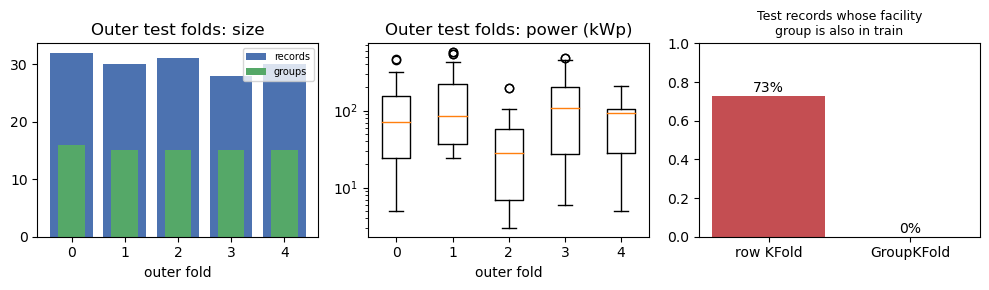

# 05 — Dondurulmuş Protokol, Hipotezler ve Veri Bölme (Görev 1.3)

> İlgili kod: [`src/s05_splits.py`](../src/s05_splits.py), [`src/rag/build_gold.py`](../src/rag/build_gold.py)
> Protokol dosyaları: [`protocol/split_manifest.csv`](../protocol/split_manifest.csv), [`protocol/qa_gold.jsonl`](../protocol/qa_gold.jsonl), [`protocol/qa_test_locked.jsonl`](../protocol/qa_test_locked.jsonl)

**Protokol sürümü: v1.0 — model eğitiminden önce donduruldu.** Bu belgedeki hiçbir karar, sonuçlar görüldükten sonra değiştirilmedi. Değişiklik gerekirse v1.1 açılır ve gerekçesi bu belgeye eklenir.

| Kilitli nesne | sha256 |
|---|---|
| `protocol/split_manifest.csv` | `e72f2b7bce3dfe3159391da805a5d8250a4253e467ecea407648a165bff4e5ac` |
| `protocol/qa_test_locked.jsonl` (20 test sorusu) | `f318984ffec954c373571bbb72f914c718f7db15d50835cb7bbb0799e30b2c71` |
| Ham Excel dosyaları | [01 §2](01_veri_denetimi.md) |

## 1. Veri sözlüğü ve dışlamalar (özet)

- Veri sözlüğü: [02 §3](02_veri_temizleme_on_isleme.md). Eşleştirme kuralları: [03](03_tesis_eslestirme.md).
- **Örnek/grup sayıları:** 153 kayıt → 82 birim → 76 değerlendirme grubu. Regresyonda **151 kayıt / 76 grup** (Ömerli 2024'teki 2 kayıt karantinada, grubu 2025 kaydıyla temsil ediliyor).
- **Dışlananlar:** Excel başlık/açıklama/boş satırları (günlüklü, [01 §3.3](01_veri_denetimi.md)); `conflict_same_year` kayıtları (yalnız regresyondan; KB'de korunur).

## 2. Girdi sözleşmesi

- **Girdi:** `district_clean`, `name_clean` (yıl kalıpları çıkarılmış), `file_year` (kategorik **kaynak sürümü**).
- **Yasak girdiler:** `power_*`, `status_*`, `record_id`, `excel_row`, `source_no`, `unit_id`, `entity_group_id`, `quality_flag` ve güçten türetilen her şey. Eşleştirme dosyası **özellik olarak** verilmez; yalnız bölme ve tesis dengeli metrik için kullanılır.
- Hedef: `z = ln(1 + power_kwp)`; tahmin `ŷ = max(0, exp(ẑ) − 1)`; metrikler kWp ölçeğinde.

## 3. Bölme manifesti (iç içe gruplu CV)

- **Dış:** `GroupKFold(n_splits=5, shuffle=True, random_state=2026)` · `groups = entity_group_id`.
- **İç:** Her dış eğitim parçasında `GroupKFold(3, shuffle=True, random_state=2026 + k)`.
- Manifest, karantinadaki kayıtlara da grubunun katını verir; bu kayıtlar hiçbir zaman fit/skor için kullanılmaz.
- **Kontroller (`check_manifest`, assert):** Her dış ve iç katta `eğitim_grupları ∩ test_grupları = ∅`; her kayıt tam bir dış katta.

| Dış kat | Test kaydı | Test grubu | Eğitim kaydı | Eğitim grubu | Test medyanı (kWp) | Test yıl dağılımı |
|---|---|---|---|---|---|---|
| 0 | 32 | 16 | 119 | 60 | 70,5 | 2022:4 · 2023:3 · 2024:9 · 2025:16 |
| 1 | 30 | 15 | 121 | 61 | 85,0 | 6 · 1 · 8 · 15 |
| 2 | 31 | 15 | 120 | 61 | **28,0** | 2 · 3 · 10 · 16 |
| 3 | 28 | 15 | 123 | 61 | 106,5 | 4 · 3 · 7 · 14 |
| 4 | 30 | 15 | 121 | 61 | 93,5 | 4 · 1 · 10 · 15 |

> Kat 2'nin medyanı düşük (itfaiye/park ağırlıklı). Gruplu bölmede bu tür kat heterojenliği kaçınılmaz; bu yüzden kat bazında sonuçlar ayrıca raporlanır, katlar arası değişkenlik belirsizliğin bir parçası olarak yorumlanır. Stratifikasyon **yapılmadı**: hedefe göre stratifikasyon, güç bilgisini bölme kararına sokmak olurdu.

**Sızıntı önizlemesi:** Rastgele satır bölmesinde (`KFold(5)`) test kayıtlarının **%72,8**'inin tesis grubu eğitimde de var; gruplu bölmede **%0**. Satır bölmesi bu yüzden yalnız **sızıntı tanısı** olarak çalıştırılır ([10](10_sonuclar_ve_ablasyon.md)).

## 4. Modeller ve hesap bütçesi (yönerge sabitleri)

| Model | Tanım | İç arama |
|---|---|---|
| B0 | Eğitim medyanı | — |
| B1 | TF-IDF (ad, 1–2 gram) + one-hot (ilçe, yıl) + Ridge, hedef `ln(1+y)` | `alpha ∈ {0.1, 1, 10, 100}` |
| D1 | Maskeli ortalama embedding → 32 gizli birim → skaler | `lr ∈ {1e-3, 3e-4} × dropout ∈ {0, 0.2}` |
| D2 | Attention pooling `eᵢ = vᵀtanh(Whᵢ+b)` → aynı başlık | aynı 4 aday |
| D3 | 2 Pre-LN encoder bloğu (d=32, h=4, d_ff=64), `[CLS]` → aynı başlık | aynı 4 aday |

- AdamW, `weight_decay = 1e-4`, batch 16, en fazla 150 epoch, iç doğrulamada `patience = 15`.
- **Seçim ölçütü:** iç doğrulama **tesis dengeli MAE (kWp)**. Seçilen aday için 3 iç katın en iyi epoch'larının **medyanı** dış eğitimdeki yeniden eğitime taşınır (erken durdurma yok).
- İç arama tek tohum (0). Dış final modeller **17, 42, 2026** tohumlarıyla eğitilir.
- Dış test puanına göre hiçbir seçim yapılmaz. Dış test tahminleri yalnız `outputs/predictions/` altına yazılır ve son raporlamada okunur.

## 5. Metrikler

- **Birincil:** tesis dengeli MAE: `MAE_fac = (1/G) Σ_g (1/n_g) Σ_{i∈g} |yᵢ − ŷᵢ|`, g = `entity_group_id`.
- **İkincil:** kayıt MAE, RMSE, R², log-MAE `|ln(1+y) − ln(1+ŷ)|`.
- 5 dış katın tahminleri birleştirilip metrik **bir kez** hesaplanır; kat ve tohum sonuçları ayrıca tabloya yazılır.
- **Tohumlar bağımsız tesis değildir:** Karşılaştırmalarda her kayıt için 3 tohumun tahmini ortalanır (tohum ortalaması tahmin). Tohumlar arası std ayrıca verilir.
- **Eşleştirilmiş grup bootstrap:** 76 gruptan iadeli 1.000 örnek, `Δ = MAE_fac(A) − MAE_fac(B)`, %95 yüzdelik aralık. Bu aralık **sabit bölmeler ve eğitim prosedürü koşullu** belirsizliği gösterir; küçük örneklem (76 grup) nedeniyle genel popülasyona genelleme iddiası taşımaz.

## 6. Hipotezler (önceden kayıtlı) ve yanlışlama ölçütleri

| # | Hipotez | Yanlışlayan gözlem |
|---|---|---|
| **H1 — Attention** | D2 (öğrenilen attention havuzlama), D1'e (maskeli ortalama) göre tesis dengeli MAE'yi düşürür: tür tokenları (`itfaiye`, `park`, `kompleksi`) ağırlıklandırılınca sinyal ortalamada sulanmaz. **Ek beklenti:** ~60 eğitim grubunda D3, B1'i geçemez. | `Δ = MAE(D2) − MAE(D1)` için %95 aralık 0'ı içeriyorsa veya tamamen > 0 ise H1 yanlışlanır. D3 − B1 aralığı tamamen < 0 ise “D3 B1'i geçemez” beklentisi yanlışlanır. |
| **H2 — Gruplama** | B1'in rastgele satır bölmesiyle ölçülen MAE'si, grup bölmesine göre ≥ %30 düşüktür. Fark, test kaydının tesisinin eğitimde bulunmasıyla açıklanır. | Göreli fark < %10 **veya** satır bölmesinde “ortak grubu olan” ve “olmayan” test kayıtlarının MAE'leri benzer. |
| **H3 — Kanıt + hesap aracı** | Toplama sorularında sayısal doğruluk R2 > R1 > R0; yanıtlanamaz sorularda doğru çekimserlik R1, R2 ≥ R0. | Toplama sorularında R2'nin sayısal doğruluğu R1'den yüksek değilse veya R1'in atıf doğruluğu R0'dan iyi değilse. (n = 6 toplama sorusu: sonuç betimsel raporlanır.) |

## 7. Zorunlu kontrollü çıkarma deneyleri

| # | Model | Değişiklik | Koşul |
|---|---|---|---|
| A1 | D2 | `α` yerine eşit ağırlık (maskeli ortalama) | D2'nin her dış katta seçilmiş ayarı ve epoch'u, aynı dış bölmeler, tohum 42, yeniden eğitim |
| A2 | D3 | konumsal kodlama yok | D3'ün seçilmiş ayarı, aynı bölmeler, tohum 42 |
| A3 | D3 | `[YIL] yil_xxxx` tokenları yok | D3'ün seçilmiş ayarı, aynı bölmeler, tohum 42 |

Ablasyonlar **ana modelin tohum 42 koşusuyla** karşılaştırılır ve üç tohumlu ana sonuçlardan **ayrı tabloda** verilir.

## 8. RAG altın soru seti (kilitli)

- 30 soru: **10 geliştirme** + **20 kilitli test** (6 tekil, 6 toplama/karşılaştırma, 4 çelişki/çok anlamlı, 4 yanıtlanamaz).
- Her soruda: beklenen yanıt, sayısal değer, tolerans, kanıt `record_id`'leri, yanıtlanabilirlik, kategori, parafraz grubu.
- **Altın yanıtlar elle yazılmadı.** `build_gold.py` her yanıtı açık bir filtre tanımıyla veriden hesaplıyor; tekil sorular tam olarak 1 kayıt döndürmezse betik duruyor.
- Test soruları prompt ve `k` seçiminden **önce** kilitlendi (sha256 yukarıda). Hocaya teslim edilecek sürüm: `protocol/qa_test_locked.jsonl`.

| Örnek | Kategori | Altın yanıt |
|---|---|---|
| T07: 2025'te açıkça “Pasif” kaç kayıt? | toplama | **15** (2 karma kayıt sayılmaz) |
| T08: 2024 Maltepe toplam güç? | toplama | 326 kWp (6 kayıt) |
| T13: 2024 Ömerli için tek güç değeri? | çelişki | Hayır: 29 kWp (s.13) ve 25 kWp (s.15) |
| T16: 2025 “Mezarlığı Hizmet ve Gasilhane” gücü? | çok anlamlı | Arnavutköy 28, Silivri 95 |
| T17: 2025 yıllık üretim kWh? | yanıtlanamaz | veride üretim yok |
