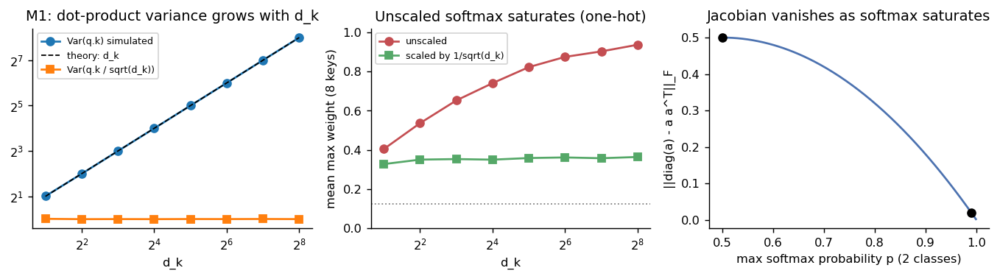
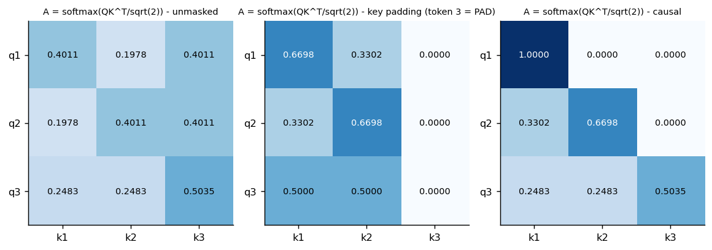

# 06 — Matematiksel Bölüm (M1–M4)

> Sayısal karşılıklar: [`src/math_checks.py`](../src/math_checks.py) · Uygulama testleri: [`tests/test_attention.py`](../tests/test_attention.py)
> Tablolar: `outputs/tables/m1_variance_simulation.csv`, `m2_values.csv`, `m3_parameters.csv`, `m3_attention_size.csv`

Her türetmede boyutlar ve varsayımlar yazıldı. Her sonucun bir sayısal veya test karşılığı var.

---

## M1 — Ölçekli noktasal attention ve gradyan

### M1.1 Boyutlar
Tek örnek, `n` token, model genişliği `d`:

| Nesne | Tanım | Boyut |
|---|---|---|
| `X` | girdi | `n × d` |
| `W_Q, W_K` | izdüşüm | `d × d_k` |
| `W_V` | izdüşüm | `d × d_v` |
| `Q = XW_Q`, `K = XW_K` | | `n × d_k` |
| `V = XW_V` | | `n × d_v` |
| `S = QKᵀ / √d_k` | skor | `n × n` |
| `A = softmax_satır(S + M)` | ağırlık | `n × n`, her satır toplamı 1 |
| `O = AV` | çıktı | `n × d_v` |

Çok başlıkta (`h` başlık) `d_k = d_v = d_h = d/h`; bizim D3'te `d = 32, h = 4 → d_h = 8`. Batch ile `Q, K, V: [B, h, n, d_h]`, `S, A: [B, h, n, n]` (koddaki `assert`'ler).

### M1.2 `Var(q·k) = d_k`
**Varsayım:** `qᵢ, kᵢ` (i = 1..d_k) karşılıklı bağımsız, `E = 0`, `Var = 1`.
1. `E[qᵢkᵢ] = E[qᵢ]E[kᵢ] = 0` (bağımsızlık).
2. `Var(qᵢkᵢ) = E[qᵢ²kᵢ²] − (E[qᵢkᵢ])² = E[qᵢ²]E[kᵢ²] − 0 = 1·1 = 1`.
3. Terimler `(qᵢkᵢ)` birbirinden bağımsız → `Var(Σᵢ qᵢkᵢ) = Σᵢ Var(qᵢkᵢ) = d_k`.
4. `Var(q·k / √d_k) = d_k / d_k = 1`.

**Doygunlukla ilişkisi:** Ölçeksiz logitlerin standart sapması `√d_k` ile büyür. İki logit arasındaki fark büyüdükçe softmax tek bir anahtara ~1 ağırlık verir (one-hot). Ölçekleme, başlangıçta logitleri birim ölçekte tutar.

**Sayısal doğrulama** (200.000 örnek, `m1_variance_simulation.csv`):

| d_k | Var(q·k) | Var(q·k/√d_k) | ort. maks ağırlık (8 anahtar), ölçeksiz | ölçekli |
|---|---|---|---|---|
| 2 | 2,02 | 1,01 | 0,40 | 0,33 |
| 8 | 7,99 | 1,00 | 0,65 | 0,35 |
| 64 | 63,95 | 1,00 | 0,88 | 0,36 |
| 256 | 255,6 | 1,00 | **0,94** | 0,36 |



**Kırılgan varsayım:** Eğitim ilerledikçe `q` ve `k` bileşenleri bağımsız ve birim varyanslı kalmaz. Ölçekleme yalnız **başlangıç** dağılımını düzeltir.

### M1.3 Softmax türevi: `∂aᵢ/∂sⱼ = aᵢ(δᵢⱼ − aⱼ)`
`aᵢ = e^{sᵢ} / Z`, `Z = Σₖ e^{sₖ}`. Bölüm kuralı:
- `i = j`: `∂aᵢ/∂sᵢ = (e^{sᵢ}Z − e^{sᵢ}e^{sᵢ}) / Z² = aᵢ − aᵢ² = aᵢ(1 − aᵢ)`
- `i ≠ j`: `∂aᵢ/∂sⱼ = (0·Z − e^{sᵢ}e^{sⱼ}) / Z² = −aᵢaⱼ`

Birleşik yazım: `∂aᵢ/∂sⱼ = aᵢ(δᵢⱼ − aⱼ)`, matris olarak `J = diag(a) − aaᵀ`.
- Dengeli `a = (0.5, 0.5)`: `J = [[0.25, −0.25], [−0.25, 0.25]]`.
- Doygun `a = (0.99, 0.01)`: `J = [[0.0099, −0.0099], [−0.0099, 0.0099]]`, yani ~25 kat küçük. Şekil 19'un sağ paneli `‖J‖_F`'nin `p → 1` iken sıfıra gittiğini gösteriyor: **doygun softmax gradyanı söndürür.**

### M1.4 `∂L/∂Q` zinciri (matris biçimi)
`G_O = ∂L/∂O` (`n × d_v`) verilsin:
1. `O = AV` → `G_A = ∂L/∂A = G_O Vᵀ` (`n × n`), `∂L/∂V = Aᵀ G_O` (`n × d_v`).
2. Satır bazlı softmax (M1.3): `(G_S)ᵢ = (G_A)ᵢ Jᵢ = Aᵢ ⊙ ((G_A)ᵢ − ⟨(G_A)ᵢ, Aᵢ⟩)`, yani `G_S = A ⊙ (G_A − rowsum(G_A ⊙ A) 1ᵀ)`.
3. `S = QKᵀ/√d_k` → `∂L/∂Q = G_S K / √d_k` (`n × d_k`), `∂L/∂K = G_Sᵀ Q / √d_k`.
4. `Q = XW_Q` → `∂L/∂W_Q = Xᵀ (∂L/∂Q)` (`d × d_k`), `∂L/∂X` üç izdüşümden toplanır.
5. Maskeli konumlarda `A = 0` olduğundan `G_S = 0`: gradyan oraya akmaz.

**Doğrulama:** `test_manual_finite_difference_dL_dQ` (merkezi fark, ε = 1e-6) ve `test_gradcheck_float64` (padding maskeli) autograd ile birebir uyuşuyor.

---

## M2 — Elle hesap ve sayısal doğrulama

`X = [[1,0],[0,1],[1,1]]`, `W_Q = W_K = W_V = I₂` → `Q = K = V = X`, `d_k = 2`, `√2 = 1.4142`.

**1) Skorlar** `QKᵀ = [[1,0,1],[0,1,1],[1,1,2]]`, `S = QKᵀ/√2`:
```
[[0.7071 0.     0.7071]
 [0.     0.7071 0.7071]
 [0.7071 0.7071 1.4142]]
```
**2) Maskesiz `A`** (satır 1: `e^0.7071 = 2.0281`, `e^0 = 1`; payda `2·2.0281 + 1 = 5.0562` → `0.4011, 0.1978, 0.4011`):
```
[[0.4011 0.1978 0.4011]
 [0.1978 0.4011 0.4011]
 [0.2483 0.2483 0.5035]]
```
**3) `O = AV`** (satır 1: `0.4011·[1,0] + 0.1978·[0,1] + 0.4011·[1,1] = [0.8022, 0.5989]`):
```
[[0.8022 0.5989]
 [0.5989 0.8022]
 [0.7517 0.7517]]
```
**4) Son token padding (anahtar maskesi)**. 3. sütun softmax'tan önce `−∞` yapılır (kodda `finfo.min`). Satır 1: `e^0.7071/(e^0.7071 + 1) = 0.6698`.
```
A_pad = [[0.6698 0.3302 0.    ]      O_pad = [[0.6698 0.3302]
         [0.3302 0.6698 0.    ]               [0.3302 0.6698]
         [0.5    0.5    0.    ]]              [0.5    0.5   ]]
```
Padding **sorgusunun** (3. satır) çıktısı son havuzlamadan çıkarılır: geçerli satırların ortalaması `[0.5, 0.5]`.

**5) Nedensel maske** (üst üçgen `−∞`):
```
A_causal = [[1.     0.     0.    ]   O_causal = [[1.     0.    ]
            [0.3302 0.6698 0.    ]               [0.3302 0.6698]
            [0.2483 0.2483 0.5035]]              [0.7517 0.7517]]
```
Son satır maskesizle aynı: son token zaten tüm geçmişi görüyor. İlk token yalnız kendine bakar (ağırlık 1).



**Kontroller (dropout kapalı):**
- Satır toplamları = 1.
- İzin verilmeyen konumlarda ağırlık tam 0.
- NumPy ↔ kendi PyTorch uygulamamız ↔ `F.scaled_dot_product_attention` birebir (`test_m2_*`).

---

## M3 — Mimari, parametre ve maliyet

### M3.1 Parametre sayımı (d_model = 32, h = 4, d_ff = 64, 2 encoder bloğu, biaslı)
Kodla gerçek modüllerden sayıldı (`test_parameter_counts`, `m3_parameters.csv`):

| Bileşen | Kural | Parametre |
|---|---|---|
| Q, K, V, O izdüşümleri | `4(d² + d) = 4(1024 + 32)` | **4.224** |
| FFN | `(d·d_ff + d_ff) + (d_ff·d + d) = 2112 + 2080` | **4.192** |
| 2 × LayerNorm | `2 × (γ: d + β: d)` | **128** |
| **Blok toplamı** | | **8.544** |
| **2 blok** | | **17.088** |
| Pre-LN son LayerNorm | `2d` | 64 |
| Token embedding | `V × 32` | sözlüğe bağlı (fold başına raporlanır, [08](08_model_mimarisi.md)) |
| Regresyon başlığı (32 → 32 → 1) | `(32·32+32) + (32+1)` | 1.089 |

Head sayısı parametreyi değiştirmez (`4d²` sabit); yalnız `d_h`'yi ve skor tensörünün boyutunu değiştirir.

### M3.2 Hesap maliyeti
- Attention: `QKᵀ` için `n·n·d_h` çarpım/başlık → toplam `O(n²d)`; `A·V` aynı mertebe. Skor tensörü `[B, h, n, n]` dizinin karesiyle büyür.
- FFN: her token için `d·d_ff` iki kez → `O(n·d·d_ff)`, n ile doğrusal.

| n | eleman/başlık | 4 başlık | `QKᵀ` çarpımı (n²d) | FFN çarpımı (2nd·d_ff) |
|---|---|---|---|---|
| 16 (bizim maks) | 256 | 1.024 | 8.192 | 65.536 |
| 64 | **4.096** | 16.384 | 131.072 | 262.144 |
| 256 | **65.536** | 262.144 | 2.097.152 | 1.048.576 |

n = 64 → 256 iken attention matrisi **16 kat** büyür; FFN yalnız 4 kat. n = 256'da attention maliyeti FFN'yi geçiyor. Bizim verimizde n ≤ 16 olduğundan **darboğaz hesap değil, veri azlığıdır.**

### M3.3 Pre-LN ve Post-LN
- **Post-LN (özgün):** `h = LN(x + MHA(x))`, `y = LN(h + FFN(h))`. Norm, artık (residual) yolun **üzerinde**.
- **Pre-LN (bizim D3):** `h = x + MHA(LN(x))`, `y = h + FFN(LN(h))`, sonda `LN_f`. Artık yol özdeşlik kalır: `∂x_L/∂x_l = I + Σ ∂F_k/∂x_l`. Derin ağda gradyan doğrudan bir yoldan taşınır, ısınmasız eğitim daha kararlıdır. Bedeli: artık akış derinlikle büyüyebildiği için son katmanda ayrı bir norm gerekir.

### M3.4 Mimari türleri
| | Maske | Cross-attention | Eğitim hedefi | Tipik kullanım |
|---|---|---|---|---|
| Encoder-only | yalnız padding (çift yönlü) | yok | maskeli dil modeli / sınıflama / regresyon | BERT |
| Decoder-only | **nedensel** + padding | yok | bir sonraki token | GPT, Qwen |
| Encoder–decoder | encoder: padding; decoder: nedensel | **var** (decoder → encoder) | seq2seq | T5, çeviri |

**Bu ödevde:**
- **Regresyon → encoder-only.** Tüm tokenlar birbirini görmeli (tesis adının sonundaki “İtfaiye” sözcüğü baştaki ilçe tokenını bağlamlandırabilir); çıktı tek skaler (`[CLS]`). Nedensel maske bilgiyi gereksiz yere kısar.
- **Yanıt üretimi → önceden eğitilmiş decoder-only instruction model** ([12](12_rag.md)). Metin üretimi otoregresiftir; sıfırdan eğitmek için veri yok.

---

## M4 — Sıra, kayıp ve genelleme

### M4.1 Permütasyon eşdeğişimi
`P` bir `n × n` permütasyon matrisi (`PᵀP = I`), konumsal kodlama yok:
- `Q' = PXW_Q = PQ`, `K' = PK`, `V' = PV`.
- `S' = PQ(PK)ᵀ/√d = P S Pᵀ`.
- Satır bazlı softmax, satır/sütunların aynı permütasyonuyla yer değiştirir: `softmax(PSPᵀ) = P softmax(S) Pᵀ`.
- `O' = P A Pᵀ P V = P A V = P O`.

Self-attention **eşdeğişimlidir**: tokenları karıştırırsan çıktı aynı şekilde karışır. FFN ve LayerNorm token bazlı olduğu için bütün blok eşdeğişimli kalır.

**Ortalama havuzlama değişmez:** `(1/n) 1ᵀ(PO) = (1/n) 1ᵀO`, çünkü `1ᵀP = 1ᵀ`. Aynı şekilde `[CLS]` sabit konumdaysa ve diğer tokenlar karıştırılırsa `[CLS]`'nin çıktısı değişmez. Test: `test_permutation_without_positions` (konumsuz D3 aynı çıktı, konumlu D3 farklı çıktı).

### M4.2 Özellik kimliği ≠ sıra konumu
- **Sıra konumu:** bir tokenın dizideki yeri. Tesis adında anlamlı (“Spor Kompleksi” ≠ “Kompleksi Spor”) → konumsal kodlama (D3'te sabit sinüzoidal).
- **Özellik kimliği:** değerin **hangi alana** ait olduğu (ilçe mi, yıl mı, ad mı). Tabular alanlarda sıra keyfîdir; önemli olan alanın kimliğidir.
- **Bizim temsilimiz:** alan işaret tokenları `[ILCE] [YIL] [MEKAN]` ve **önekli değer tokenları** `ilce_fatih`, `yil_2024` ([07](07_tokenizasyon_ve_girdi.md)). Böylece özellik kimliği konuma değil token kimliğine gömülür. Konum kaldırılsa bile (ablasyon A2) alanlar ayırt edilebilir; yalnız ad içindeki sözcük sırası kaybolur. Örnek: Fatih'teki “**Silivri** Kapı Buz Pisti” adındaki `silivri` sözcüğü, Silivri ilçe tokenı `ilce_silivri` ile karışmaz.

### M4.3 Log-hedef, ters dönüşüm yanlılığı, kayıp ≠ metrik
- **Log-hedef** `z = ln(1+y)`: 3–574 kWp aralığını 1,4–6,4'e sıkıştırır (çarpıklık 1,90 → −0,17, [04](04_kesifsel_veri_analizi.md)). MSE log uzayında **göreli** hatayı cezalandırır; 500 kWp'lik tesisin mutlak hatası kayba hükmetmez.
- **Ters dönüşüm yanlılığı:** Model `ẑ ≈ E[z|x]` öğrenir. `exp` dışbükey olduğundan Jensen: `exp(E[z|x]) ≤ E[exp(z)|x]`. Yani `ŷ = exp(ẑ) − 1` koşullu **ortalamayı değil, (log-normal varsayımda) koşullu medyanı** kestirir ve sistematik olarak **eksik kestirir**. Log-normal artıklarda düzeltme `exp(σ²/2)`; parametrik olmayan alternatif Duan smearing (`(1/n) Σ exp(rᵢ)`). Protokolde ana modele düzeltme **uygulanmadı** (yönergede sabit dönüşüm). Etkisi [10](10_sonuclar_ve_ablasyon.md)'da tartışılıyor.
- **Kayıp ≠ metrik:** Eğitim kaybı log-MSE (göreli), raporlanan birincil metrik kWp cinsinden tesis dengeli MAE (mutlak). 500 kWp'de %20 hata = 100 kWp; 5 kWp'de %20 = 1 kWp. Log kaybını iyi optimize eden model, kWp MAE'de büyük tesislerdeki eksik kestirim yüzünden kötü görünebilir.
- **Bias–variance ve parametre/tesis oranı:** D3 ≈ 17.088 + 1.153 + V·32 (V ≈ 130 → ~22–23 bin) parametre, buna karşı her dış eğitimde ~60 **bağımsız** tesis grubu var: grup başına ~370 parametre → **yüksek varyans** rejimi. Dropout, weight decay ve iç doğrulamayla erken durdurma bu yüzden zorunlu. B1'in etkin serbestlik derecesi Ridge cezasıyla çok daha düşük; küçük veride daha iyi genelleyebilir. Kayıt sayısı (~120) bağımsız örnek sayısını abartır, çünkü aynı tesisin yılları neredeyse aynı gürültüsüz örnek ([04](04_kesifsel_veri_analizi.md) §6).
