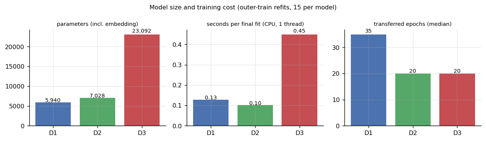

# 08 — Model Mimarisi

> İlgili kod: [`src/models.py`](../src/models.py), [`src/attention.py`](../src/attention.py) · Testler: [`tests/test_attention.py`](../tests/test_attention.py)

## 1. Model ailesi ve adil karşılaştırma

| Model | Fikir | Tokenlar birbirini görür mü? | Parametre (dış eğitim ort.) |
|---|---|---|---|
| **B0** | eğitim medyanı | — | 0 |
| **B1** | TF-IDF (ad, 1–2 gram) + one-hot (ilçe, yıl) + Ridge | — (doğrusal) | ~özellik sayısı + 1 |
| **D1** | maskeli ortalama embedding → MLP | hayır | 5.940 |
| **D2** | öğrenilen tek sorgulu attention havuzlama → MLP | hayır | 7.028 |
| **D3** | 2 Pre-LN Transformer encoder bloğu → `[CLS]` → MLP | **evet** (self-attention) | 23.092 |

D1, D2 ve D3 için ortak tutulanlar: **aynı sözlük kuralı, aynı dış ve iç bölmeler, aynı hedef dönüşümü, aynı embedding boyutu (32), aynı regresyon başlığı (32 → 32 → 1, ReLU, dropout), aynı optimizer ve aynı hiperparametre ızgarası.** Böylece farklar mimariden gelir.

## 2. Ortak regresyon başlığı
```
r ∈ ℝ^{B×32} → Linear(32,32) → ReLU → Dropout(p) → Linear(32,1) → ẑ ∈ ℝ^{B}
```
Parametre `(32·32+32) + (32+1) = 1.089`.

## 3. D1 — Maskeli ortalama
```
E = Emb(ids)                      [B, T, 32]
m = (ids ≠ PAD)                   [B, T]
h̄ = Σ_t m_t E_t / Σ_t m_t         [B, 32]
ẑ = Head(h̄)
```
Sırasızdır (bag-of-embeddings); permütasyona değişmez. Parametre: `V·32 + 1.089`.

## 4. D2 — Attention havuzlama (yönergedeki denklem)
```
h_i = E_i                                       [B, T, 32]
e_i = vᵀ tanh(W h_i + b)     W: 32×32, b: 32, v: 32     → e ∈ [B, T]
e_i = finfo.min  (PAD)                          maske softmax'tan ÖNCE
α   = softmax(e)  (T ekseninde)                 [B, T],  Σ_i α_i = 1, α_PAD = 0
r   = Σ_i α_i h_i                               [B, 32]
ẑ   = Head(r)
```
- Havuzlama parametresi `W + b + v = 1.024 + 32 + 32 = 1.088`.
- **D2 ≠ D3:** D2'de tek, öğrenilen ve **girdiden bağımsız** bir sorgu yönü (`v`) var; her token **ayrı ayrı** puanlanır, tokenlar birbirini görmez, temsiller bağlamsallaşmaz. Karmaşıklık `O(T·d²)`. D3'te her token her tokena sorgu atar (`O(T²·d)`) ve temsiller bağlamsallaşır.
- **Ablasyon A1** (`equal_weights=True`): `α_i = m_i / Σm`, yani D1'in havuzlaması + D2'nin kullanılmayan havuzlama parametreleri. Fark yalnız ağırlıklandırmadan gelir.

## 5. D3 — Pre-LN Transformer encoder

```
x_0 = Emb(ids) + PE[:T]                        [B, T, 32]   PE: sabit sinüzoidal (0 parametre)
for l in 1..2:
    h   = x + Drop( MHA( LN₁(x), key_padding_mask ) )
    x   = h + Drop( FFN( LN₂(h) ) )             FFN: Linear(32,64) → GELU → Linear(64,32)
x_L = LN_f(x)
ẑ   = Head( x_L[:, 0] )                          [CLS] okuması
```

**MHA (sıfırdan, [`attention.py`](../src/attention.py)):**
```
qkv = Linear(32, 96)(x)                          [B, T, 96]     (W_Q, W_K, W_V yan yana)
q,k,v = chunk(3)                                 3 × [B, T, 32]
q = q.view(B,T,4,8).transpose(1,2)               [B, 4, T, 8]   (k, v aynı)
S = q @ kᵀ / √8                                  [B, 4, T, T]   ← √d_h, √d_model DEĞİL
S = S.masked_fill(pad[:,None,None,:], finfo.min) anahtar maskesi
A = softmax(S, dim=-1); A[maskeli] = 0; tamamen maskeli satır → 0
A = Dropout(A)
o = A @ v                                        [B, 4, T, 8]
o = o.transpose(1,2).reshape(B,T,32)             transpose ÖNCE (yanlış reshape testle yakalanıyor)
out = Linear(32, 32)(o)                          W_O
```
- Hazır `nn.MultiheadAttention` / `nn.TransformerEncoder` **kullanılmadı**; yalnız testte referans olarak ağırlıklar kopyalanıp karşılaştırıldı (`test_matches_torch_multiheadattention`, fark < 1e-5).
- **Konum:** sabit sinüzoidal. Öğrenilen konum embedding'i 64·32 = 2.048 ek parametre getirirdi; ~60 grupluk veride bundan kaçınıldı. **Ablasyon A2:** `PE = 0`.
- **Yıl:** **Ablasyon A3**, `[YIL] yil_xxxx` tokenlarını diziden ve sözlükten çıkarır.
- **Tamamen maskeli satır:** `[CLS]` hiç maskelenmediği için gerçek veride oluşmaz. Yine de tanımlı: çıktı 0, NaN yok (`test_fully_masked_row_no_nan`). Tek tokenlı dizide attention kendine 1 ağırlık verir (`test_single_token_sequence`).

**Parametre dökümü (D3, testle doğrulanmış):**

| Parça | Parametre |
|---|---|
| Embedding `V × 32` (V = 145–157) | 4.640–5.024 |
| Blok × 2 (her biri: attention 4.224 + FFN 4.192 + 2×LN 128) | 17.088 |
| Son LayerNorm | 64 |
| Başlık | 1.089 |
| **Toplam** | **22.881–23.265** |



## 6. Uygulama doğrulaması (zorunlu kontroller + ek testler)

`tests/test_attention.py`, **23 test, hepsi geçiyor**:

| Kontrol | Test |
|---|---|
| Padding eklenince kestirim değişmez (D1, D2, D3) | `test_padding_invariance` |
| Attention satır toplamları = 1 | `test_rows_sum_to_one_and_masked_weights_zero` |
| Maske dışındaki (PAD) ağırlıklar tam 0 | aynı test + `test_d2_alpha_masked_and_normalised` |
| M2 elle hesap (maskesiz, padding, nedensel) | `test_m2_unmasked`, `test_m2_key_padding`, `test_m2_causal`, `test_m2_matches_torch_sdpa` |
| Gradyan, sonlu farkla | `test_manual_finite_difference_dL_dQ`, `test_gradcheck_float64` |
| Tamamen maskeli satır / tek token | `test_fully_masked_row_no_nan`, `test_single_token_sequence` |
| Bağımsız referans | `test_matches_torch_multiheadattention` |
| **Negatif kontroller** (hata bilerek yapılır, test yakalar) | `test_wrong_head_merge_is_detected` (transpose'suz reshape), `test_wrong_scale_is_detected` (√d_model) |
| Permütasyon (M4) | `test_permutation_without_positions` |
| Parametre sayısı = elle hesap | `test_parameter_counts` |
| Batch ↔ tek örnek, determinizm, küçük batch'e aşırı uyum | `test_batch_equals_single`, `test_determinism_same_seed`, `test_overfit_tiny_batch` |
