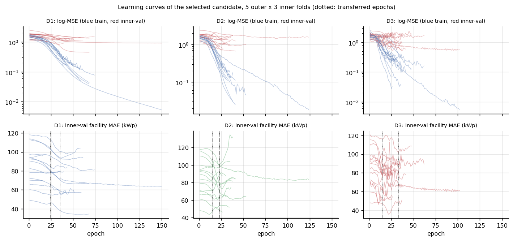
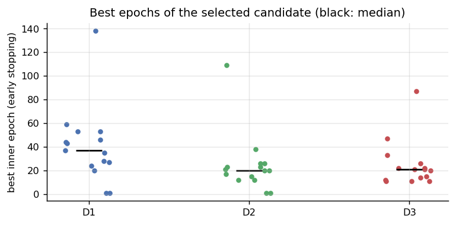
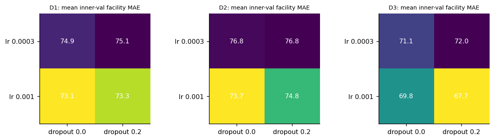
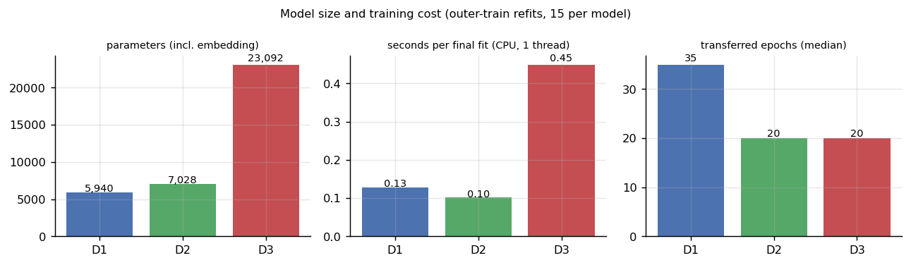

# 09 — Eğitim ve Deney Düzeni

> İlgili kod: [`src/train.py`](../src/train.py) (`main`, `ablations`, `leakage` modları), [`src/metrics.py`](../src/metrics.py)
> Tablolar: `outputs/tables/selection_*.csv`, `learning_curves_*.csv`, `fold_info_*.csv`, `hyperparameter_grid_mean.csv`

## 1. Eğitim öncesi: ne kilitlendi?

Eğitim başlamadan önce [05 — Protokol](05_protokol_ve_bolme.md) donduruldu: bölme manifesti (sha256), aday ızgarası, epoch politikası, tohumlar, metrikler, hipotezler, ablasyonlar ve kilitli RAG test soruları. Eğitim kodu dış test etiketlerine yalnız **son tahmin yazılırken** dokunuyor; hiçbir seçim (ayar, epoch, alpha) dış teste bakarak yapılmadı.

## 2. Prosedür (her model için)

```
for dış_kat k in 0..4:
    D_tr = dış eğitim (k dışındaki katlar)          ~120 kayıt, ~61 grup
    D_te = dış test (k)                              ~30 kayıt, ~15 grup
    for aday c in {lr ∈ (1e-3, 3e-4)} × {dropout ∈ (0, 0.2)}:
        for iç_kat j in 0..2:                        (manifestteki inner_fold_o{k})
            sözlük ← yalnız iç eğitim
            eğit: AdamW(lr, wd=1e-4), batch 16, MSE(z), en fazla 150 epoch
            her epoch: iç doğrulama tesis dengeli MAE (kWp)
            erken durdurma: 15 epoch iyileşme yoksa dur; en iyi epoch'u kaydet
        skor(c) = 3 iç katın en iyi MAE ortalaması
    c* = argmin skor;  E* = medyan(c*'ın 3 iç en iyi epoch'u)
    for tohum in (17, 42, 2026):
        sözlük ← tüm D_tr
        c* ile tam E* epoch eğit (erken durdurma YOK)
        D_te'yi tahmin et → outputs/predictions/
```
- **İç arama tohumu:** 0. **Final tohumları:** 17, 42, 2026.
- **B1:** aynı iç katlarda `alpha ∈ {0.1, 1, 10, 100}`; deterministik olduğu için tohum fark etmez (3 tohum satırı aynı tahmini taşır).
- **B0:** dış eğitim medyanı.
- Sinir ağlarında başlık bias'ı eğitim `z` ortalamasıyla başlatılır ([07 §6](07_tokenizasyon_ve_girdi.md)).
- **Determinizm:** `torch.manual_seed`, `torch.use_deterministic_algorithms(True)`, `torch.set_num_threads(1)`, karıştırma için ayrı `torch.Generator`. Model küçük olduğu için tüm eğitim CPU'da (GPU'da çekirdek seçimi deterministikliği bozabilir; hız farkı yok).

## 3. Eğitim sırasında: öğrenme eğrileri



- **Eğitim kaybı (mavi) hızla düşüyor, iç doğrulama kaybı (kırmızı) erken düzleşiyor.** ~120 kayıtla modeller eğitim adlarını kolayca ezberliyor. Sınırlayıcı faktör kapasite değil, genelleme.
- Doğrulama MAE eğrileri kata göre çok farklı seviyelerde (40–120 kWp): iç doğrulama grubunda büyük bir tesis (Buz Pisti, Fatih Spor) olup olmaması seviyeyi belirliyor.
- D3'ün doğrulama eğrisi daha gürültülü (attention + dropout + küçük doğrulama kümesi).
- Noktalı çizgiler dış eğitime taşınan epoch sayıları.



| Model | Taşınan epoch (5 dış kat) | Medyan |
|---|---|---|
| D1 | 53, 28, 24, 35, 53 | 35 |
| D2 | 23, 20, 15, 20, 23 | 20 |
| D3 | 33, 11, 21, 20, 15 | 20 |

## 4. Hiperparametre seçimi



İç doğrulama tesis dengeli MAE'si (5 dış katın ortalaması):

| Model | lr 3e-4, drop 0 | lr 3e-4, drop 0.2 | lr 1e-3, drop 0 | lr 1e-3, drop 0.2 |
|---|---|---|---|---|
| D1 | 74,9 | 75,1 | **73,1** | 73,3 |
| D2 | 76,8 | 76,8 | **73,7** | 74,8 |
| D3 | 71,1 | 72,0 | 69,8 | **67,7** |

Dış katlarda seçilen ayarlar (`fold_info_*.csv`):

| Dış kat | D1 (lr, drop) | D2 | D3 | B1 alpha |
|---|---|---|---|---|
| 0 | 1e-3, 0 | 1e-3, 0.2 | 3e-4, 0 | 1 |
| 1 | 1e-3, 0 | 1e-3, 0 | 1e-3, 0 | 0.1 |
| 2 | 1e-3, 0.2 | 1e-3, 0 | 1e-3, 0.2 | 1 |
| 3 | 1e-3, 0.2 | 1e-3, 0.2 | 1e-3, 0.2 | 1 |
| 4 | 1e-3, 0 | 1e-3, 0 | 1e-3, 0.2 | 1 |

Izgara farkları küçük (1–3 kWp). Bu, seçimin gürültüye duyarlı olduğunu ve iç doğrulama skorunun dış test için iyimser olabileceğini gösteriyor. D3'ün iç skoru (67,7) dış test skorundan (76,2) belirgin düşük: **seçim iyimserliği** (winner's curse).

## 5. Ablasyon ve sızıntı koşuları

- `python train.py ablations`: A1/A2/A3 için **ana modelin her dış katta seçilmiş ayarı ve epoch'u** (`fold_info_*.csv`, tohum 42 satırı) okunur, yeniden arama yapılmaz. Aynı dış bölmelerde **tohum 42** ile yeniden eğitilir.
- `python train.py leakage`: B1 rastgele **satır** `KFold(5)` ile (iç `KFold(3)` satır bazlı) çalıştırılır. Yalnız tanı amaçlı.

## 6. Eğitim maliyeti



| Model | Parametre (ort.) | Final fit süresi (s, CPU 1 iş parçacığı) | Tüm ana deney |
|---|---|---|---|
| D1 | 5.940 | 0,13 | 16,9 s |
| D2 | 7.028 | 0,10 | 13,5 s |
| D3 | 23.092 | 0,45 | 47,5 s |
| **Tümü (B0+B1+D1–D3, iç arama dahil)** | | | **≈ 80 s** |

Donanım: Intel x86-64 CPU (tek iş parçacığı), PyTorch 2.13.0, Python 3.12.3. GPU (RTX 2050) bu adımda kullanılmadı.

## 7. Eğitim sonrası

Dış test tahminleri `outputs/predictions/outer_predictions_{main,ablations,leakage}.csv` dosyalarına yazılır. Tek okuyucu [`src/evaluate.py`](../src/evaluate.py) ve [`src/error_analysis.py`](../src/error_analysis.py). Sonuçlar: [10](10_sonuclar_ve_ablasyon.md), [11](11_hata_analizi.md). Tohum 42 modellerinin ağırlıkları `outputs/models/` altında; yalnız hata analizinde attention haritası ve token silme için kullanılır.
