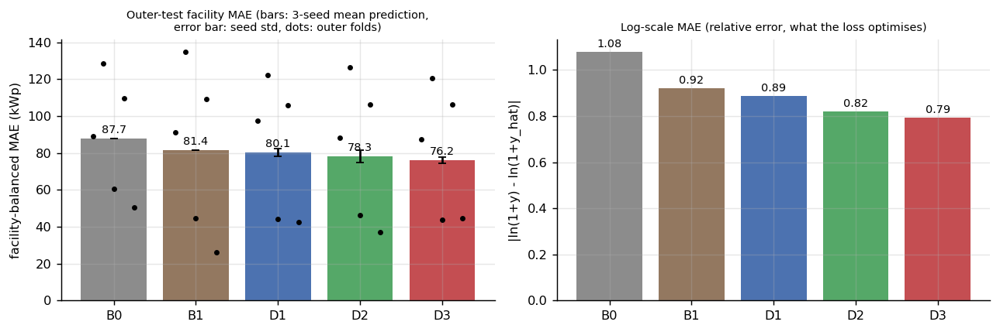
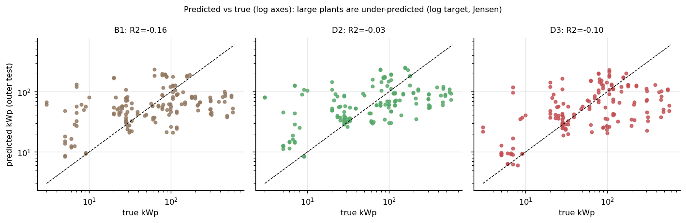
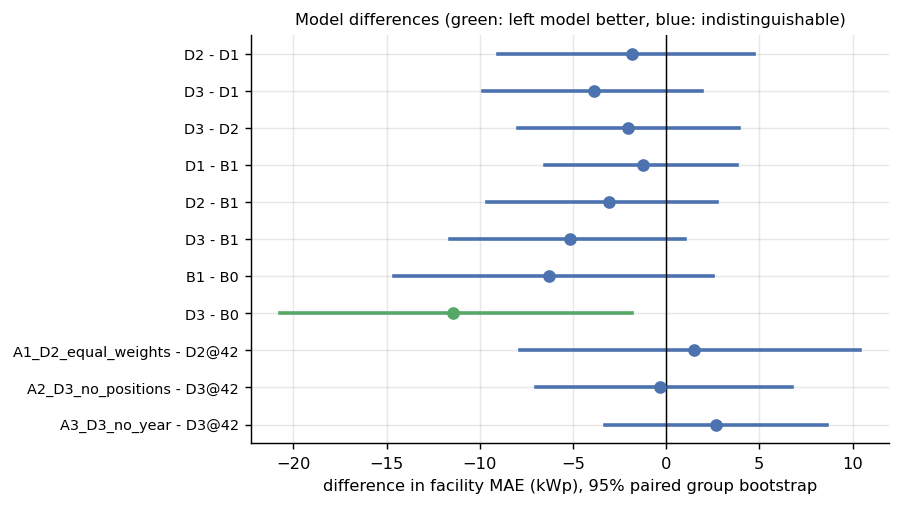
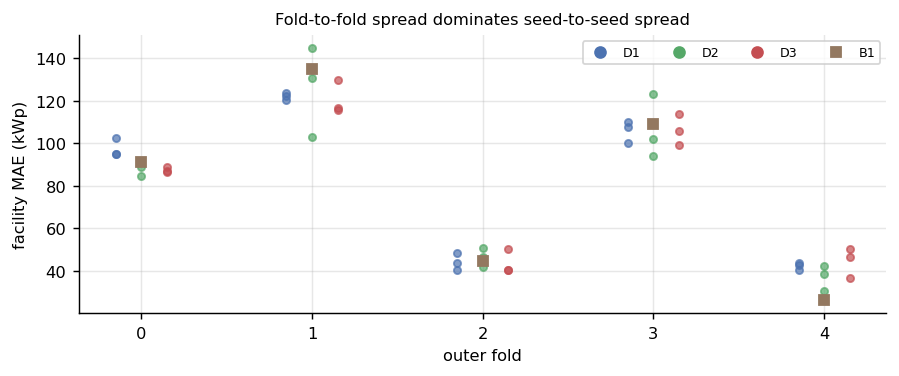
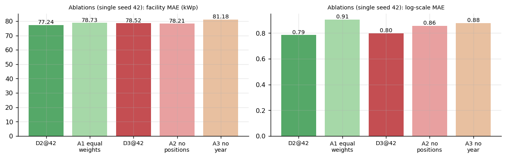
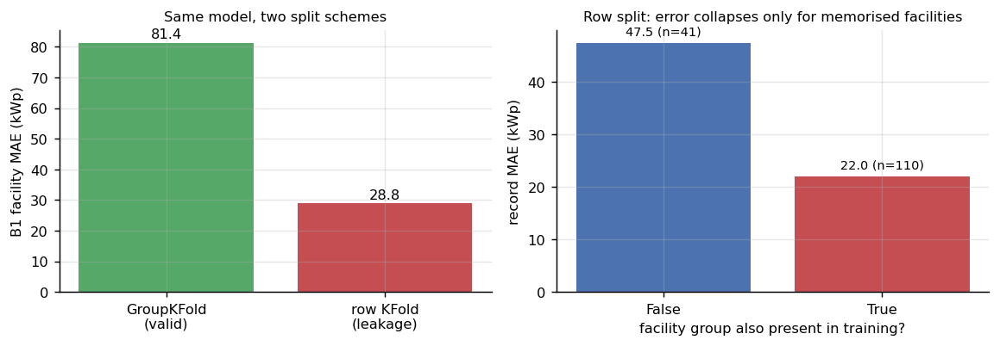
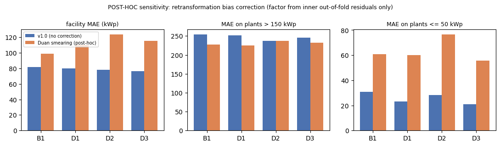

# 10 — Sonuçlar, Ablasyonlar ve Sızıntı Tanısı

> İlgili kod: [`src/evaluate.py`](../src/evaluate.py)
> Tablolar: `outputs/tables/results_main.csv`, `results_by_fold_seed.csv`, `bootstrap_differences.csv`, `results_ablations.csv`, `results_leakage.csv`
> Tüm sayılar **5 dış katın birleştirilmiş tahminleri** üzerinde, 151 kayıt / 76 tesis grubu, kWp ölçeğinde.

## 1. Ana sonuç (görülmemiş tesislere genelleme)

| Model | **Tesis dengeli MAE** | Kayıt MAE | RMSE | R² | log-MAE | Tohum std (MAE_fac) | Tek tohum aralığı |
|---|---|---|---|---|---|---|---|
| B0 medyan | 87,66 | 89,94 | 143,9 | −0,14 | 1,078 | — | — |
| B1 TF-IDF + Ridge | 81,36 | 86,40 | 144,8 | −0,16 | 0,922 | — | — |
| D1 ortalama | 80,11 | 84,39 | 143,5 | −0,14 | 0,887 | 2,12 | 79,9–85,1 |
| D2 attention havuzlama | 78,29 | 81,35 | **136,7** | **−0,03** | 0,820 | 3,47 | 77,2–85,6 |
| D3 Transformer | **76,22** | **80,62** | 141,2 | −0,10 | **0,793** | 1,69 | 78,5–82,7 |

Sinir ağlarının satırları **3 tohumun ortalama tahmini** ile hesaplandı. Bu ortalama küçük bir topluluk (ensemble) etkisi yaratır: D3'ün tek tohum skorları 78,5–82,7 aralığında, ortalama tahmini ise 76,2.

**Okuma:**
1. **Hiçbir model büyük tesisleri öğrenemiyor.** Tüm modellerde R² ≤ 0: kare hata ölçüsünde hiçbir model sabit tahmini anlamlı biçimde geçmiyor. RMSE'ye 450–574 kWp'lik birkaç tesis hükmediyor ([11](11_hata_analizi.md)).
2. **Göreli (log) hatada iyileşme belirgin.** log-MAE 1,08 → 0,79. Modeller, eğitim kaybının ölçtüğü şeyi (göreli hata) gerçekten iyileştiriyor. kWp MAE'deki kazanç bunun çok gerisinde, çünkü log hedefi ve Jensen etkisi büyük tesisleri eksik kestiriyor ([06 M4.3](06_matematik.md)).
3. Sıralama D3 < D2 < D1 < B1 < B0 olsa da farkların çoğu **istatistiksel olarak ayırt edilemiyor** (§2).

## 2. Model farkları — eşleştirilmiş grup bootstrap (1.000 tekrar)

| Karşılaştırma (A − B) | Δ MAE_fac | %95 aralık | P(A daha iyi) | Hüküm |
|---|---|---|---|---|
| D2 − D1 | −1,82 | [−9,04, 4,73] | 0,72 | ayırt edilemez |
| D3 − D1 | −3,89 | [−9,85, 1,95] | 0,92 | ayırt edilemez |
| D3 − D2 | −2,07 | [−7,95, 3,92] | 0,75 | ayırt edilemez |
| D1 − B1 | −1,26 | [−6,49, 3,81] | 0,68 | ayırt edilemez |
| D2 − B1 | −3,07 | [−9,62, 2,71] | 0,85 | ayırt edilemez |
| D3 − B1 | −5,14 | [−11,58, 1,02] | 0,95 | ayırt edilemez (sınırda) |
| B1 − B0 | −6,30 | [−14,62, 2,50] | 0,93 | ayırt edilemez |
| **D3 − B0** | **−11,44** | **[−20,71, −1,85]** | 0,99 | **D3 daha iyi** |

> **Kapsam notu:** Bu aralıklar **sabit bölmeler ve sabit eğitim prosedürü koşulunda**, test tesis gruplarının yeniden örneklenmesinden gelen belirsizliği gösterir. Farklı bir bölme tohumu, farklı aday ızgarası veya başka bir şehrin verisi bu belirsizliğe dahil değil. 76 grupla bu aralıklar geniş; küçük farkların “gerçek” olduğunu iddia etmek mümkün değil.

## 3. Kat ve tohum değişkenliği

| Dış kat | B0 | B1 | D1 | D2 | D3 |
|---|---|---|---|---|---|
| 0 | 89,0 | 91,3 | 97,3 | 88,2 | 87,4 |
| 1 | 128,6 | 134,8 | 122,2 | 126,3 | 120,6 |
| 2 | 60,6 | 44,8 | 44,2 | 46,4 | 43,7 |
| 3 | 109,6 | 109,1 | 105,9 | 106,5 | 106,4 |
| 4 | 50,4 | **26,1** | 42,3 | 37,2 | 44,5 |

(Sinir ağları için 3 tohumun kat MAE'si ortalaması.)

**Katlar arası fark (26–135 kWp), tohumlar arası farktan (std 1,7–3,5) çok daha büyük.** Hangi tesislerin teste düştüğü sonucu, modelden çok daha fazla belirliyor. B1 kat 4'te açık ara en iyi, kat 0'da en kötülerden biri: tek kata bakarak model seçmek yanıltıcı olurdu.

## 4. Zorunlu ablasyonlar (tek tohum = 42; ana tablodan ayrı)

| Ablasyon | Taban (tohum 42) | MAE_fac taban → ablasyon | log-MAE taban → ablasyon | Δ MAE_fac [%95] | Hüküm |
|---|---|---|---|---|---|
| **A1** D2 eşit ağırlık | D2 | 77,24 → 78,73 | 0,786 → **0,906** | +1,49 [−7,87, 10,37] | MAE_fac ayırt edilemez; log-MAE'de attention ağırlıkları yardımcı |
| **A2** D3 konum yok | D3 | 78,52 → 78,21 | 0,799 → 0,857 | −0,31 [−6,98, 6,73] | ayırt edilemez |
| **A3** D3 yıl yok | D3 | 78,52 → 81,18 | 0,799 → 0,878 | +2,66 [−3,31, 8,61] | ayırt edilemez; yönü “yıl bilgisi az da olsa yardımcı” |

**Yorum:**
- **A1:** Öğrenilen ağırlıkların kaldırılması **log** hatasını belirgin artırıyor (0,79 → 0,91), kWp MAE'sini ise ayırt edilebilir biçimde artırmıyor. Attention ağırlıkları tür tokenlarına odaklanarak göreli hatayı iyileştiriyor; büyük tesislerin mutlak hatası ise bu iyileşmeyi örtüyor.
- **A2:** Konum bilgisi bu kısa ve alan işaretli dizilerde fark yaratmıyor. Beklenen bir sonuç: özellik kimliği önekli tokenlarla zaten taşınıyor ([07](07_tokenizasyon_ve_girdi.md)), ad sözcüklerinin sırası güç için az bilgi taşıyor.
- **A3:** Yıl tokenı çıkarılınca hata hafifçe artıyor, ama aralık 0'ı içeriyor. Yıl kalıpları ad metninden temizlendiği için ([02](02_veri_temizleme_on_isleme.md)) bu ablasyon gerçekten yıl bilgisinin çıkarılmasını ölçüyor. Kalan `çatısı`/`ibb` sinyali tam izolasyonu engelliyor ve sınırlılık olarak not edildi.

## 5. Sızıntı tanısı — **GEÇERLİ GENELLEME SKORU DEĞİLDİR**

Aynı B1 modeli, aynı alpha araması; tek fark bölme şekli:

| Bölme | MAE_fac | Kayıt MAE | RMSE | R² | Test kaydının grubu eğitimde |
|---|---|---|---|---|---|
| GroupKFold (geçerli) | 81,36 | 86,40 | 144,8 | −0,16 | %0 |
| **Rastgele satır KFold (SIZINTI)** | **28,84** | 28,92 | 64,5 | **0,77** | **%72,8** |
| ↳ satır bölmesi, grubu eğitimde **var** (n=110) | | **22,0** | 42,0 | 0,91 | |
| ↳ satır bölmesi, grubu eğitimde **yok** (n=41) | | 47,5 | 102,9 | −0,01 | |

Satır bölmesi hatayı **%65 düşürüyor** ve R²'yi 0,77'ye çıkarıyor. Bu iyileşmenin tamamı, aynı tesisin başka yıldaki kaydının eğitimde bulunmasından geliyor. Grubu eğitimde olmayan 41 kayıtta R² yine ≈ 0. Satır bölmesiyle raporlanan bir “R² = 0,77” bu veride **ezber**dir.

## 6. Hipotezlerin akıbeti

| Hipotez | Sonuç | Kanıt |
|---|---|---|
| **H1** D2 < D1 (attention havuzlama faydalı) | **Yanlışlandı** (tesis dengeli MAE'de). Yön doğru (−1,8 kWp), %95 aralık 0'ı içeriyor | §2, D2 − D1. Ek bulgu: log-MAE'de D2 belirgin daha iyi (A1: 0,79 vs 0,91) |
| H1 ek beklentisi: D3, B1'i geçemez | **Doğrulandı** (ayırt edilemez; aralık [−11,6, 1,0]) | §2, D3 − B1 |
| **H2** satır bölmesi ≥ %30 daha düşük MAE, ortak grupla açıklanır | **Doğrulandı**: %65 düşük; ortak gruplu kayıtta 22 kWp, ortak grupsuz kayıtta 47,5 kWp | §5 |
| **H3** RAG + hesap aracı | [12 — RAG](12_rag.md) | |

## 7. Sonuç cümlesi

> ~60 bağımsız eğitim tesisiyle attention tabanlı modeller (D2, D3), basit modellere göre **göreli hatada** tutarlı bir iyileşme gösteriyor (log-MAE 0,92 → 0,79). **Görülmemiş tesislerin kWp cinsinden kurulu gücünü** kestirmede ise TF-IDF + Ridge'den ayırt edilebilir biçimde daha iyi değiller. Yalnız D3, medyan referansını %95 güvenle geçiyor. Asıl belirleyici olan model değil, test katına hangi büyük ve tekil tesislerin düştüğü. Satır bölmesiyle elde edilecek yüksek skorlar sızıntıdır.

## 8. Protokol sonrası duyarlılık analizi (v1.1): log dönüşüm yanlılığı düzeltmesi

> **Bu bölüm v1.0 sonuçları görüldükten SONRA eklendi.** Ana tabloyu değiştirmez ve hiçbir model seçiminde kullanılmadı. Kod: [`src/posthoc_smearing.py`](../src/posthoc_smearing.py) · Tablolar: `posthoc_smearing.csv`, `posthoc_smearing_factors.csv`

**Soru:** Büyük tesislerin eksik kestirimi, log hedefin ters dönüşüm yanlılığından mı geliyor ([06 M4.3](06_matematik.md), Jensen)?

**Yöntem:** Duan smearing, `ŷ = exp(ẑ) · s − 1`, `s = mean(exp(r))`. Dış kat k için `s`, **yalnız** dış eğitimin iç katlarından gelen tahmin dışı (out-of-fold) artıklardan hesaplandı: ana modelle aynı seçilmiş ayar ve epoch, tohum 0. Dış test etiketleri `s`'nin hesabına girmedi.

| Model | s (5 katın ort.) | MAE_fac v1.0 → smearing | Δ [%95] | > 150 kWp MAE | ≤ 50 kWp MAE | R² |
|---|---|---|---|---|---|---|
| B1 | 1,67 | 81,4 → 98,9 | +17,6 [6,5, 29,1] | 254 → 227 | 31 → 61 | −0,16 → −0,21 |
| D1 | 2,03 | 80,1 → 109,8 | +29,7 [12,2, 48,2] | 251 → 225 | 23 → 60 | −0,14 → −0,47 |
| D2 | 2,11 | 78,3 → 123,6 | +45,3 [22,6, 71,3] | 237 → 237 | 28 → 77 | −0,03 → −0,71 |
| D3 | 1,98 | 76,2 → 115,5 | +39,3 [19,8, 59,8] | 245 → 232 | 21 → 56 | −0,10 → −0,59 |

**Bulgu:** Düzeltme her modelde hatayı **anlamlı biçimde artırıyor.** Çarpımsal katsayı (~2) tüm tahminleri yaklaşık ikiye katlıyor:
- küçük tesislerin hatası 2–3 katına çıkıyor;
- büyük tesislerde kazanç yalnız 0–30 kWp, çünkü 574 kWp'lik bir tesisi 50 kWp tahmin eden bir model, 2 ile çarpılınca da 100 kWp tahmin ediyor.

**Yorum:** Büyük tesislerdeki eksik kestirimin ana nedeni dönüşüm yanlılığı **değil**, **bilgi eksikliği**: bu tesislerin türü eğitimde yok ya da ad tokenları `[UNK]` ([11](11_hata_analizi.md)). Jensen etkisi var (artıklar büyük ve heteroskedastik, s ≈ 2), ama homojen bir çarpımsal düzeltme bu veride yanlış araç. Protokolde düzeltme uygulanmaması, sonradan bakıldığında doğru bir karardı.
