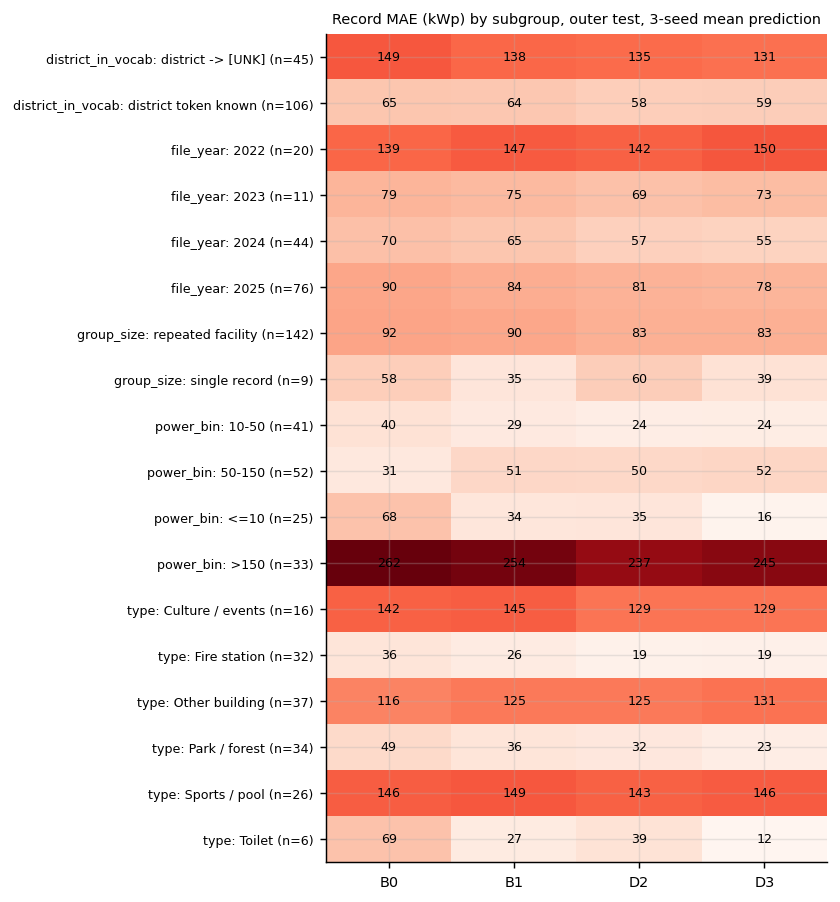
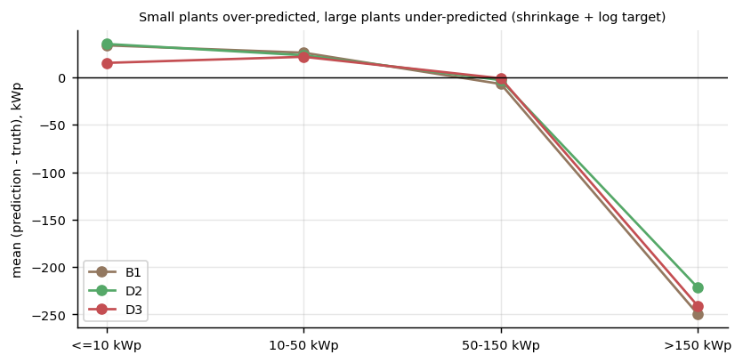
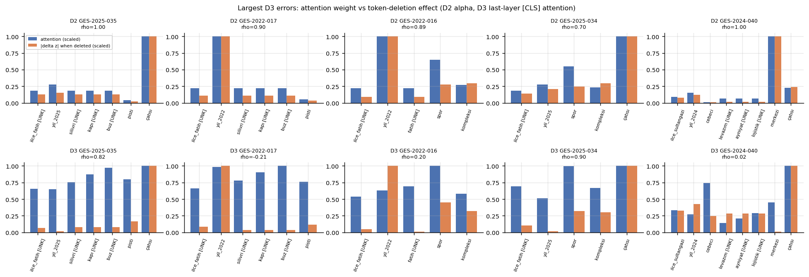

# 11 — Hata Analizi ve Attention Yorumu

> İlgili kod: [`src/error_analysis.py`](../src/error_analysis.py)
> Tablolar: `outputs/tables/error_subgroups.csv`, `largest_errors_D3.csv`, `attention_vs_deletion.csv`, `attention_vs_deletion_summary.csv`

## 1. En büyük hatalar (D3, 3 tohum ortalama tahmini)

| record_id | İlçe | Tesis | Dosya | Gerçek | D3 | B1 | |hata| |
|---|---|---|---|---|---|---|---|
| GES-2025-035 | Fatih | Silivri Kapı Buz Pisti | 2025 | 574 | 48 | 46 | 526 |
| GES-2022-017 | Fatih | Silivri Kapı Buz Pisti | 2022 | 574,2 | 59 | 53 | 516 |
| GES-2022-016 | Fatih | Fatih Spor Kompleksi | 2022 | 550 | 107 | 88 | 443 |
| GES-2025-034 | Fatih | Spor Kompleksi | 2025 | 550 | 110 | 82 | 440 |
| GES-2024-040 | Sultangazi | Cebeci Levazım Ayniyat Lojistik Merkezi | 2024 | 484 | 46 | 38 | 438 |
| GES-2025-067 | Sultangazi | Cebeci Levazım Ayniyat Lojistik Merkezi | 2025 | 484 | 51 | 40 | 433 |
| GES-2025-056 | Pendik | Tepeören Hayvan Barınağı | 2025 | 451 | 38 | 68 | 413 |
| GES-2022-018 | Pendik | Tepeören Hayvan Barınağı | 2022 | 452 | 74 | 101 | 378 |

**Hata sınıflandırması (elle):**
1. **Benzersiz tür (6/8):** Buz pisti, lojistik merkezi ve hayvan barınağının eğitimde benzeri yok. Bu kayıtlarda 3–4 token `[UNK]` (`buz`, `pisti`, `levazım`, `barınağı` …; `attention_vs_deletion.csv` → `n_unk`). Model türü bilmeyince küçük/orta tesis ortalamasına çekiyor. Bu kayıtlarda tahmini en çok değiştiren token çoğunlukla `yil_2022`, `ilce_pendik` veya `çatısı`. Ad bilgisi `[UNK]`'e düşünce model yıl/ilçe gibi zayıf sinyallere yaslanıyor.
   **Bilinen tür, olağan dışı büyüklük (2/8):** Fatih Spor Kompleksi. “spor kompleksi” eğitimde var, ama diğer örneklerin aralığı 78–428 kWp (çoğu ~118). 550 kWp bu türün kuyruğunda; model türün tipik değerini (~110) veriyor.
2. **Aynı ilçede büyük tesis kümesi:** Fatih'in 4 büyük kaydı (Buz Pisti ×2, Spor Kompleksi ×2) aynı dış katta. Gruplu bölme doğru çalışıyor ama bu, o katta eğitimde hiç “Fatih büyük tesis” örneği bırakmıyor.
3. **Log hedef + küçültme (shrinkage):** Tüm modeller 450–574 kWp'yi 40–110 kWp tahmin ediyor. Jensen eksik kestirimi ve küçük veride ortalamaya çekilme birlikte etkili (Şekil 30).
4. **Aynı tesisin iki yılı aynı hatayı tekrarlıyor:** 8 hatanın 4 çifti aynı tesis. Tesis dengeli MAE'nin bu çiftleri tek tesis saymasının gerekçesi bu.

## 2. Alt grup hataları

D3 kayıt MAE'si (kWp), n parantez içinde:

| Faktör | Düzey | MAE | Ortalama işaretli hata (tahmin − gerçek) |
|---|---|---|---|
| Güç aralığı | ≤ 10 kWp (25) | 15,6 | +15,3 |
| | 10–50 (41) | 24,3 | +21,7 |
| | 50–150 (52) | 51,9 | −0,9 |
| | **> 150 (33)** | **245,1** | **−241,2** |
| İlçe tokenı | eğitimde biliniyor (106) | 59,2 | −20,5 |
| | **`[UNK]`** (45) | **131,1** | −101,4 |
| Tür | İtfaiye (32) | **19,5** | −6,7 |
| | Park / orman (34) | 22,9 | +10,5 |
| | Tuvalet (6) | 12,1 | +12,1 |
| | Spor / havuz (26) | 146,5 | −81,9 |
| | Kültür / etkinlik (16) | 128,8 | −109,9 |
| | Diğer bina (37) | 130,5 | −82,7 |
| Dosya | 2022 (20) | 150,0 | −82,4 |
| | 2024 (44) | 54,7 | −30,0 |

**Yorum:**
- **Sistematik küçültme:** Küçük tesisler (≤ 50 kWp) fazla, büyükler (> 150 kWp) ağır biçimde eksik kestiriliyor. Bu, log hedefli ve az veriyle eğitilmiş bir regresyonun beklenen davranışı. B1, D2 ve D3'te aynı desen var (Şekil 30); yani mimariye değil veri ve hedefe ait.
- **Tür bilgisi işe yarıyor:** İtfaiye (19,5) ve park (22,9) çok iyi kestiriliyor; bu türlerin adı belirleyici ve güç aralıkları dar. Hata, “diğer bina”, spor ve kültür gibi geniş aralıklı türlerde yoğunlaşıyor.
- **`[UNK]` ilçe etkisi karışık:** `[UNK]` ilçeli kayıtların MAE'si 2 kattan fazla. Ancak Fatih (büyük tesisler) bu grupta olduğu için etki tür ve büyüklükle **karışık**; nedensel bir “ilçe bilinmezse hata artar” iddiası kurulmamalı.
- **2022 dosyasının yüksek hatası:** 2022, büyük tesislerin çoğunu içeriyor (medyan 106). Bu bir “yıl etkisi” değil, dosya bileşimi.

## 3. Attention haritası ≠ açıklama: token silme ile karşılaştırma

**Yöntem:** Her test kaydı için tohum 42 modeli yüklenir:
- **D2:** havuzlama ağırlıkları `α_i`;
- **D3:** son katman, başlıkların ortalaması, `[CLS]` satırı.

Her özel olmayan token tek tek silinip `|Δẑ|` (log ölçekte tahmin değişimi) ölçülür. Kayıt başına attention ile silme etkisi arasında Spearman ρ hesaplanır.

| Model | Kayıt | Medyan ρ | Ortalama ρ | En yüksek attention tokenı = en etkili silme tokenı |
|---|---|---|---|---|
| D2 | 151 | **0,83** | 0,76 | %71 |
| D3 | 151 | 0,41 | 0,35 | %40 |

**Yorum:**
- **D2'de attention ile silme etkisi güçlü uyumlu.** Bu beklenen bir sonuç: D2'de çıktı `r = Σ α_i h_i`, yani yüksek ağırlıklı tokenı silmek havuzlanmış vektörü doğrudan değiştirir. Uyum, “attention = neden” anlamına gelmez; mimarinin doğrudan bir sonucu.
- **D3'te uyum zayıf.** Son katman `[CLS]` ağırlığı, tokenın tahmine etkisinin yarı yarıya iyi bir göstergesi bile değil. Bilgi, artık (residual) akış ve önceki katman üzerinden de taşınıyor; yüksek ağırlıklı bir token silindiğinde başka tokenlar onun bilgisini zaten taşıyor olabilir.
- En büyük hatalarda (Şekil 31) D3 sıklıkla `[UNK]` ya da ilçe tokenına yüksek ağırlık veriyor, ama tahmini en çok değiştiren token farklı.
- **Sonuç:** Attention ağırlıkları yalnız başına **nedensel önem veya açıklama olarak sunulmadı.** Bu raporda attention haritası yalnız token silme deneyiyle birlikte ve bu sınırlılıkla yorumlandı.

## 4. Ne iyileştirebilirdi? (yapılmadı, protokol dışı)
- Hedefi `log` yerine kWp MAE ile uyumlu bir kayıpla optimize etmek ya da Duan smearing düzeltmesi (büyük tesis eksik kestirimini azaltır, küçükleri bozar).
- Tesis türü için dış bilgi (bina alanı, çatı alanı). Veride yok.
- Daha fazla bağımsız tesis. Asıl darboğaz bu.
