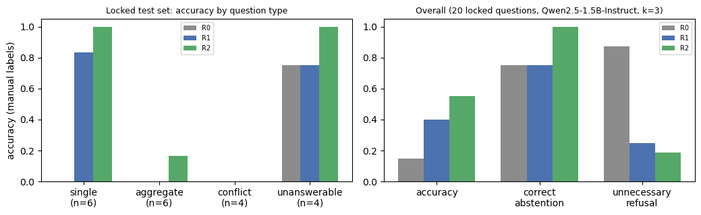
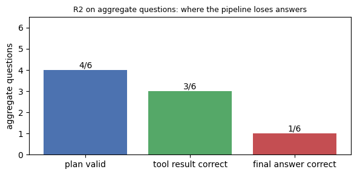

# 12 — Kanıta Dayalı Soru-Cevap (RAG)

> İlgili kod: [`src/rag/kb.py`](../src/rag/kb.py) (bilgi tabanı, BM25, hesap aracı), [`src/rag/llm.py`](../src/rag/llm.py), [`src/rag/systems.py`](../src/rag/systems.py), [`src/rag/eval_rag.py`](../src/rag/eval_rag.py), [`src/rag/build_gold.py`](../src/rag/build_gold.py)
> Altın set: [`protocol/qa_gold.jsonl`](../protocol/qa_gold.jsonl) · Kilitli test: [`protocol/qa_test_locked.jsonl`](../protocol/qa_test_locked.jsonl)

> **Durum:** Kilitli 20 test sorusu, dev setinde seçilen ayarlarla (k = 3) **bir kez** çalıştırıldı. 60 yanıtın tamamı elle puanlandı. Sonuçlar §6–§8'de.

## 1. Bilgi tabanı (regresyondan ayrı)
- **153 satır belgesi**, karantinadaki Ömerli kayıtları dahil. Her belgede `record_id`, dosya adı, sayfa, Excel satırı, dosya yılı (“kurulum yılı değil” notuyla), ilçe, tam mekan adı, güç, ham durum ve kalite uyarıları (çelişki, ilçe çelişkisi, etap, belirsiz/karma durum) yer alır.
- KB yalnız `records_clean.csv` okur. Regresyon tahminlerine, bölmelere veya modellere erişmez. **RAG başarısı regresyon başarısı olarak sunulmaz.**

## 2. LLM (sıfırdan eğitim yok)
| Alan | Değer |
|---|---|
| Model | `Qwen/Qwen2.5-1.5B-Instruct` (Hugging Face, Apache-2.0) |
| Nicemleme | yok, fp16 |
| Donanım | NVIDIA RTX 2050 (4 GB), GPU belleği ≈ 3,1 GB |
| Üretim | greedy (`do_sample=False`), cevap `max_new_tokens=320`, plan `120` |
| Ortam | `PYTORCH_CUDA_ALLOC_CONF=expandable_segments:True` (aksi hâlde k=10 promptlarında bellek yetmiyor) |
| Kart | `outputs/tables/rag_llm_card.json` |

## 3. Üç sistem (aynı model, aynı soru, aynı üretim bütçesi)
- **R0, kanıtsız LLM:** yalnız soru.
- **R1, RAG:** BM25 (`rank_bm25`, Türkçe-duyarlı tokenizasyon; ilçe + ad + yıl + durum indekslenir) ile ilk k belge. Prompt: her olguya `[record_id]` atfı, çelişkide tüm değerler, kanıt yoksa “bu bilgi yok”.
- **R2, RAG + hesap aracı:**
  1. LLM soruyu JSON **sorgu planına** çevirir (`lookup | count | sum | max | min | list | compare_years | unanswerable`; filtreler `file_year, district, status, name_contains, min_power`).
  2. `validate_plan` beyaz liste dışındaki intent/filtreleri reddeder. `run_tool` yalnız izinli pandas filtre/sayım/toplamlarını **tüm tablo** üzerinde çalıştırır (ilk-k üzerinden toplam yok). **LLM'in ürettiği kod hiçbir zaman çalıştırılmaz.**
  3. Hesap sonucu, eşleşen tüm `record_id`'ler ve BM25 kanıtı ile LLM yanıtı yazar.
- Her sorgu için plan, getirilen `record_id`'ler, hesap sonucu, yanıt ve süre `outputs/rag_runs/*.json`'a kaydedilir (git dışı).

## 4. Puanlama
- **Otomatik kurallar** (`eval_rag.py`, testten önce yazıldı): sayısal toleransla eşleşme, çelişki sorularında tüm değerlerin geçmesi, çekimserlik ifadeleri, atıf çıkarımı (`GES-YYYY-RRR`), sayısal iddiaların kanıtla desteklenmesi.
- **Nihai etiket elle verilir:** test yanıtlarının hepsi okunur, `outputs/tables/rag_manual_review.csv` yazılır. LLM hakem kullanılmaz.
- Metrikler: tekil sorularda Recall@k, doğruluk, sayısal doğruluk, atıf doğruluğu, kanıt kapsamı, doğru çekimserlik, gereksiz ret. Boş paydalar “uygulanamaz”.

## 5. Geliştirme seti: k seçimi ve prompt geliştirme (yalnız dev)
| k | Dev doğruluk (R1) | Recall@k (tekil) |
|---|---|---|
| **3** | **0,5** | 1,0 |
| 5 | 0,4 | 1,0 |
| 10 | 0,3 | 1,0 |

Seçim kuralı: en yüksek dev doğruluğu → recall → küçük k. **Seçilen k = 3.** Daha çok belge, küçük modelin dikkatini dağıtıp yanlış satırdan sayı çekmesine yol açtı.

Dev'de görülen sorun ve düzeltme: R1, “Aktif - Pasif” ve “(Aktif / Pasif)” kayıtları için yalnız “Aktif” yanıtı verdi. Prompta “ham durumu aynen aktar, karma/belirsizse kesin olmadığını söyle, UYARI/NOT ifadelerini ekle” talimatı eklendi. Puanlayıcıdaki çekimserlik ifadesine “bilgisi yok” kalıbı eklendi.

Dev setinde üç sistem (k = 3, otomatik puan, n = 10):

| Sistem | Doğruluk | Sayısal doğruluk | Toplama | Doğru çekimserlik | Gereksiz ret |
|---|---|---|---|---|---|
| R0 | 0,1 | 0,0 | 0,00 | 0,0 | 0,25 |
| R1 | 0,5 | 0,4 | 0,00 | 1,0 | 0,25 |
| R2 | **0,7** | **0,6** | 0,33 | 1,0 | 0,125 |

Toplama sorularında R1'in sıfır alması beklenen bir sonuç: ilk 3 belgeden toplam/sayım yapılamaz. R2'nin hesap aracı bu sınıfta fark yaratıyor. Bu dev sonuçlarıdır; H3'ün sınanması kilitli test setiyle yapılacak.

## 6. Kilitli test sonuçları (20 soru, elle puan)

Test seti çalıştırılmadan önce sha256 değeri doğrulandı (`eval_rag.py` → `LOCKED_SHA`). Prompt, k ve puanlama kuralları dev setinde dondurulmuştu; testten sonra hiçbiri değiştirilmedi.

| Sistem | **Doğruluk** | Tekil (6) | Toplama (6) | Çelişki (4) | Yanıtlanamaz (4) | Sayısal doğruluk | Recall@3 (tekil) | Atıf doğruluğu | Kanıt kapsamı | **Doğru çekimserlik** | **Gereksiz ret** | Ort. süre (s) |
|---|---|---|---|---|---|---|---|---|---|---|---|---|
| R0 kanıtsız | 0,15 | 0,00 | 0,00 | 0,00 | 0,75 | 0,00 | uygulanamaz | uygulanamaz | 0,00 | 0,75 | **0,875** | 3,4 |
| R1 BM25 RAG | 0,40 | 0,83 | 0,00 | 0,00 | 0,75 | 0,45 | 1,00 | 1,00 | 0,69 | 0,75 | 0,25 | 2,2 |
| R2 RAG + araç | **0,55** | **1,00** | 0,17 | 0,00 | **1,00** | **0,55** | 1,00 | 0,83 | 0,70 | **1,00** | **0,19** | 3,7 |

- Sayısal doğruluk paydası: sayısal altın yanıtı olan 11 soru. Atıf doğruluğu: destekleyen atıf / tüm atıf (az atıf yapıldı: R1 3, R2 6). Kanıt kapsamı: yanıttaki sayısal iddialardan kanıtla desteklenenlerin oranı.
- Otomatik ve elle puan uyumu: R0 0,90, R1 0,95, R2 1,00. Farkların çoğu R0'ın “bu bilgiye ulaşamadım” biçimindeki çekimserliklerinin otomatik kuralca yakalanamamasından geliyor. **Nihai tablo elle verilen etiketlerdir** (`outputs/tables/rag_manual_review.csv`, `rag_test_metrics_final.csv`).

## 7. Hata sınıflandırması (elle, `rag_error_classes.csv`)

| Hata sınıfı | Sistem | Adet | Örnek |
|---|---|---|---|
| **Halüsinasyon** | R0 | 3 | T18: “2019 yılında devreye girdi”; T14: “Kumburgaz ilçesi” diye bir ilçe uyduruyor |
| **Dosya yılı = kurulum tarihi** | R1 | 1 | T18: kanıttaki 2024/2025 dosya yılını “devreye alındı” diye sunuyor. Ödevin uyardığı tuzak; R2 bu soruda doğru çekimser |
| **İlk-k ile toplam/sayım** | R1 | 5 | T08: 3 kaydın toplamı 119 kWp (gerçek 326); T09: 3 kayıt (gerçek 5) |
| **Çelişkiyi tek değere indirgeme** | R1, R2 | 5 | T15: üç değeri listeleyip “80 kWp” seçiyor; T16: Arnavutköy 28 verip Silivri 95'i atlıyor |
| **Araç doğru, aktarım yanlış** | R2 | 3 | T08: araç 326 kWp hesapladı, LLM 129 yazdı; T09: araç 5, LLM 3; T16: araç iki kaydı döndürdü, LLM birini yazdı |
| **Planlayıcı şema ihlali** | R2 | 2 | T10, T12: beyaz listede olmayan `power_kwp` filtresi → doğrulayıcı reddetti (güvenli başarısızlık) |
| **Planlayıcı yanlış filtre** | R2 | 4 | T07: `district="Durum"`; T13: ilçe adını ad filtresine koydu → 0 satır; T14: tesis adını ilçe alanına koydu |
| **Gereksiz ret** | R0 | 14 | kanıt erişimi olmadan tüm yanıtlanabilir soruları reddediyor |
| Atıf yok / bozuk atıf | R1, R2 | 9 | doğru değer, ama `[GES-…]` kimliği yok veya uydurma formatta (T03) |
| Kendisiyle çelişen yanıt | R1 | 1 | T04: 8,5 kWp deyip ardından “bu bilgi yok” |

## 8. R2 boru hattı tanısı: yanıtlar nerede kayboluyor?

Toplama sorularında (6): planlayıcı **4**'ünde geçerli plan üretti, araç **3**'ünde doğru sayıyı hesapladı (T08 326, T09 5, T11 2850,1), LLM bunların yalnız **1**'ini (T11) doğru aktardı. Tekil sorularda planlayıcı ilçe/ilçe benzeri sözcükleri (`Tuzla`, `Kadıköy`, `Pendik`, `Maltepe`) ad filtresine kattığı için araç 6 sorunun 4'ünde 0 satır döndü; doğru yanıtlar BM25 kanıtından geldi (`rag_r2_tool_diagnostics.csv`).

**Darboğaz kodda değil, 1,5 milyar parametreli modelde.** Model, (a) JSON şemasına uymakta ve (b) kendisine verilen hesap sonucunu sadakatle aktarmakta zorlanıyor. Kod tarafı güvenli davranıyor: geçersiz plan reddediliyor, hiçbir keyfî kod çalıştırılmıyor, toplamlar tüm tablo üzerinden hesaplanıyor.

## 9. H3'ün akıbeti

| Beklenti | Gözlem | Hüküm |
|---|---|---|
| Toplama sorularında sayısal doğruluk R2 > R1 > R0 | R2 1/6, R1 0/6, R0 0/6 | Yön tutuyor ama fark tek soruya dayanıyor (n = 6). **Zayıf destek**, betimsel |
| Yanıtlanamaz sorularda doğru çekimserlik R1, R2 ≥ R0 | R2 1,00 ≥ R1 0,75 = R0 0,75 | **Destekleniyor** |
| R1'in atıf doğruluğu R0'dan iyi | R0 hiç atıf yapmıyor (uygulanamaz); R1'in atıfları %100 destekli | Destekleniyor (R0 için ölçüt tanımsız) |
| Genel | Kanıt (R1) doğruluğu 0,15 → 0,40, hesap aracı (R2) 0,55 yapıyor; gereksiz ret 0,875 → 0,19 | Kanıt getirme ve araç **yardımcı**. Çelişki sorularında üç sistem de başarısız (0/4) |

**Sonuç:** Bu veride bir dil modeli **tekil kayıt** sorularına (kanıtla 5–6/6) ve **yanıtlanamaz** soruları reddetmeye (R2 4/4) güvenilir biçimde yanıt verebiliyor. **Toplama** ve özellikle **çelişki/çok anlamlı** sorularda küçük bir yerel model, doğru hesap sonucu elinde olsa bile güvenilir değil. Bu tür sorularda yanıtın kendisi LLM'e bırakılmadan, araç çıktısından şablonla üretilmeli. Bu öneri test sonucundan sonra yazıldı ve ölçülmedi.

**Sınırlılıklar:** n = 20; tek model (Qwen2.5-1.5B, kaynak kısıtı nedeniyle); greedy üretim; elle puanlama tek kişi tarafından yapıldı.
